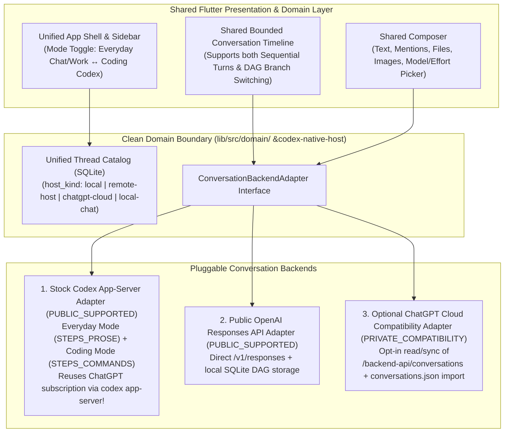

# ChatGPT Desktop (`26.1103.32239`) — Cloud Chat History Sync & Compatibility Assessment

> **Scope**: Deep-dive analysis of how official ChatGPT Desktop synchronizes, stores, and mutates Cloud ChatGPT conversations and Unified Projects, paired with a public/private compatibility assessment and the recommended **Phase 1 Native Chat Architecture** for `Codex-Native-Unoffical`.

---

## 1. How Official ChatGPT Desktop Syncs & Renders Cloud Chat History

### 1.1 Cloud Catalog Synchronization (`ThreadCatalogSyncManager` in `early-bootstrap-920`)

In ChatGPT Desktop `26.1103.32239`, Cloud Chat conversations are **not** managed by a separate sidebar or separate database. Instead, when a user signs in with a ChatGPT account, the main process registers a virtual catalog host in `~/.codex/sqlite/codex.db`:

- **Host Identifier**: `chatgpt:<accountId>:<userId>` (`hostKind: "chatgpt"`, `sourceKind: "chatgpt"`).
- **Sync Parameters**:
  - `resumeOffsetPagination: true`
  - `maxHistoryAgeMs: 2592000000` (**30 days** — older unpinned cloud conversations are not bulk-synced into local SQLite unless searched or opened directly).
  - `failureBackoffMs: 300000` (**5 minutes** backoff on HTTP error/rate-limit).
- **Pagination Loop (`listPage`)**:
  - Calls `GET https://chatgpt.com/backend-api/conversations?offset=${offset}&limit=100&order=updated&is_archived=false&hide_snorlax=false`.
  - Normalizes each item via `ehy(hostId, item)` into `local_thread_catalog`:
    - `thread_id = item.id`
    - `title = item.title`
    - `project_id = item.gizmo_id?.startsWith("g-p-") ? item.gizmo_id : null`
    - `conversation_origin = item.conversation_origin` (`"chatgpt"`, `"work"`, or `"tpp"`)
    - `chatgpt_async_status = item.async_status`
    - `pinned = Boolean(item.is_starred)`
    - `archived = Boolean(item.is_archived)`
- **Single-Item Refresh (`readItem`)**:
  - Calls `POST https://chatgpt.com/backend-api/conversations/batch` with `{ conversation_ids: [threadId] }`.

### 1.2 Message Tree DAG (`MrGp` & `AuIy.Ph` in `182735.d3d917f28d.js`)

Unlike `codex app-server` threads (which organize history into sequential `Turn` entities containing `Item` arrays), Cloud ChatGPT conversations use a **Directed Acyclic Graph (DAG)** of message nodes (`MrGp`):

```json
{
  "conversation_id": "67f0...",
  "title": "Architecture review",
  "current_node": "node-uuid-4",
  "mapping": {
    "node-uuid-1": {
      "id": "node-uuid-1",
      "parent": null,
      "children": ["node-uuid-2"],
      "message": { "id": "node-uuid-1", "author": { "role": "system" }, "content": { "content_type": "text", "parts": [""] } }
    },
    "node-uuid-2": {
      "id": "node-uuid-2",
      "parent": "node-uuid-1",
      "children": ["node-uuid-3a", "node-uuid-3b"],
      "message": { "id": "node-uuid-2", "author": { "role": "user" }, "content": { "content_type": "text", "parts": ["Explain..."] } }
    }
  },
  "pagination": {
    "cursor": "opaque-cursor",
    "numTurns": 20
  }
}
```

- **Active Branch Projection (`AuIy.Ph`)**:
  - Starts at `current_node` and walks `parent` pointers back to the root (`parent === null` or `paginated-root:*`), reversing the path into the active linear sequence of turns.
- **Branching, Editing, and Regeneration**:
  - **Edit User Message**: Sends `POST /backend-api/f/conversation` (`action: "next"`) with `parent_message_id` set to the original user message's `parent`, appending a new child ID to `mapping[parent].children` and updating `current_node`.
  - **Regenerate Assistant Response (`submitChatGPTRegeneration`)**: Sends `POST /backend-api/f/conversation` (`action: "variant"`) with `parent_message_id` set to the user message ID, creating a sibling assistant node (`displayOrder` variants in `MrGp.en`).
  - **Switch Branch (`< 1 / 2 >`)**: Selects a different child in `mapping[parentId].children` and updates `current_node` to the leaf of that subtree.
- **Older History Pagination (`MrGp.en` & `et`)**:
  - Very long cloud conversations return a truncated `mapping` rooted at a synthetic `"paginated-root:<id>"` node plus `pagination: { cursor, numTurns }`.
  - Scrolling near the top fetches the older page via `cursor` and splices the older nodes above `"paginated-root:<id>"` via `MrGp.et`.

### 1.3 Unified Projects (`codex_unified_projects` & `g-p-*` Snorlax Gizmos)

One of the most notable product integrations in `26.1103.32239` is **Unified Projects**:
- Cloud ChatGPT Projects are represented as Snorlax gizmos with IDs prefixed `g-p-...` (`/backend-api/gizmos/snorlax/sidebar`).
- Local Codex workspace projects (`state_5.sqlite` `projects` + `project_roots`) can be linked 1-to-1 with a `g-p-...` cloud project via `chatGptBacking: { accountId, userId, projectId: "g-p-..." }` stored in `~/.codex/project-chatgpt-provisioning/<sha256>.json`.
- When linked, both local `codex app-server` threads (`project_id = localProjectId`) and cloud Chat/Work conversations (`gizmo_id = "g-p-..."`) appear together inside the same Project folder in the sidebar!

---

## 2. Compatibility & Risk Classification Matrix

| Capability / Surface | Classification | Technical & Policy Reality |
| :--- | :--- | :--- |
| **Stock `codex app-server` OAuth (`~/.codex/auth.json`) & Local RPC (`thread/*`, `turn/*`)** | `PUBLIC_SUPPORTED` | Officially supported by OpenAI's open-source `openai/codex` CLI/app-server using the user's ChatGPT Plus/Pro/Team subscription or API key. |
| **OpenAI Responses API (`POST https://api.openai.com/v1/responses` / `/v1/conversations`)** | `PUBLIC_SUPPORTED` | Official, documented, versioned public REST/SSE API for chat, reasoning, web search, file search, code interpreter, and MCP tools. |
| **ChatGPT Export Archive Import (`conversations.json` from ChatGPT Data Export ZIP)** | `PUBLIC_SUPPORTED` | User-owned data export format (`mapping` + `current_node` JSON array); 100% offline, zero rate-limit or sentinel risk. |
| **Cloud Chat Catalog Sync (`GET /backend-api/conversations`, `POST /conversations/batch`, `GET /conversation/:id`)** | `PRIVATE_COMPATIBILITY` | Undocumented internal web/desktop REST endpoints. Require ChatGPT bearer token + `ChatGPT-Account-Id`. Read-only metadata/history sync is relatively low-friction in desktop contexts when reusing `auth.json` tokens and a 5-minute failure backoff, but schemas can change without notice. |
| **Cloud Chat Completion Submission (`POST /backend-api/f/conversation`)** | `PRIVATE_COMPATIBILITY` | Undocumented internal completion endpoint. On web/unofficial clients, `/backend-api/f/conversation` is frequently guarded by proof-of-work (`oai-sentinel-chat-requirements-token`), Turnstile/Arkose challenges, and `DeviceCheck` headers (`X-OpenAI-Attach-DeviceCheck-Token`). High breakage risk if used as the primary chat engine. |
| **Cloud Gizmo / Snorlax Project Sync (`/backend-api/gizmos/snorlax/*`)** | `PRIVATE_COMPATIBILITY` | Internal project endpoint; useful as an optional read/link adapter behind a feature flag. |

---

## 3. Recommended Phase 1 Native Chat Architecture for `Codex-Native-Unoffical`

Based on our reverse analysis and the project's core principles (**clean adapter boundaries, bounded UI projections, zero fragile dependencies in the core domain**), we recommend a **3-Adapter Pluggable Chat Backend** under a unified `ConversationRepository` interface:



### 3.1 Why This Strategy Wins

1. **Immediate "Everyday Chat + Work" via Stock `codex app-server` (`PUBLIC_SUPPORTED`)**:
   - Official ChatGPT Desktop itself implements Everyday/Work mode by running `codex app-server` with `conversationDetailMode = "STEPS_PROSE"` (`usesCondensedPresentation = true`, `includeProseDetailLevelInstructions = true`)!
   - Because stock `codex app-server` already authenticates with the user's ChatGPT subscription (`~/.codex/auth.json`) without sentinel/Arkose blocks, our Native client can deliver a first-class **"Everyday (Chat/Work)"** experience immediately on top of `codex app-server` (projectless threads + prose detail mode) with **zero private-API breakage risk**.
2. **Offline / Export History Import (`PUBLIC_SUPPORTED`)**:
   - Implement a zero-dependency importer for ChatGPT's official `conversations.json` export archive directly into our local SQLite catalog (`local_thread_catalog` + `chat_message_nodes` DAG table) and `FTS5` search index so users can bring their entire multi-year ChatGPT history into the native client immediately.
3. **Isolated Optional Cloud Sync Adapter (`PRIVATE_COMPATIBILITY`)**:
   - Keep `/backend-api/conversations` and `/backend-api/conversation/:id` strictly isolated inside an opt-in `ChatGptCloudSyncAdapter` module in `codex-native-host` (respecting the official 30-day window and 5-minute backoff), so any upstream changes to `/backend-api/*` never break the core app.
