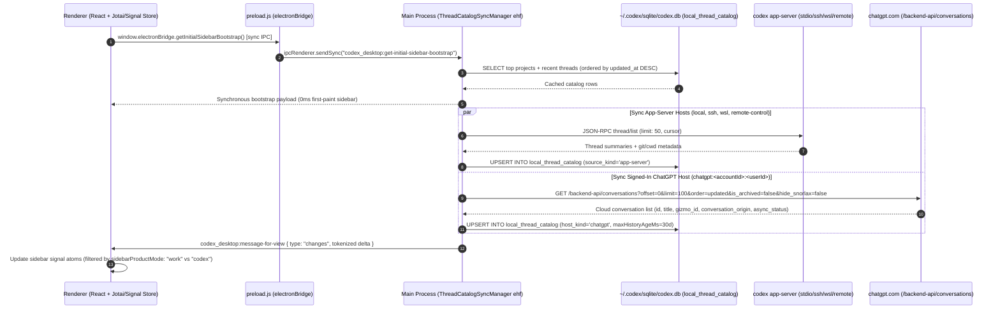

# ChatGPT Desktop (`26.1103.32239`) — End-to-End Data Flows & State Ownership

> **Scope**: Documents the runtime state machines, data-flow pipelines, hydration/pagination algorithms, viewport-protected eviction rules, and shared vs mode-specific boundaries across **Chat**, **Work**, and **Codex**.

---

## 1. Unified Startup & Sidebar Catalog Data Flow

### 1.1 Zero-Flicker Bootstrap + Multi-Host Sync (`early-bootstrap-920`)



### 1.2 Shared Catalog Row Normalization (`ehy` in `early-bootstrap-920`)

Every conversation—whether local Codex CLI, SSH remote, WSL, Remote Control, or Cloud ChatGPT—is normalized into `local_thread_catalog` with a composite primary key `(host_id, thread_id)`:

- `host_kind`: `'local' | 'ssh' | 'wsl' | 'remote-control' | 'chatgpt'`
- `source_kind`: `'app-server'` or `'chatgpt'`
- `conversation_origin`: `'chatgpt'` (mapped to `'chat'`), `'work'`, `'tpp'` (Third-Party/Local Executor, mapped to `'work'`), or `NULL` (native Codex thread)
- `project_id`: Local project UUID or cloud Gizmo ID (`g-p-...` when `gizmo_id?.startsWith("g-p-")`)
- `chatgpt_async_status`: Background cloud task status (`in_progress`, `completed`, `failed`, etc.)

---

## 2. Mode 1: Cloud Chat Data Flow (`conversation_origin = "chatgpt"`)

### 2.1 Opening & Hydrating a Cloud Chat Conversation

```text
[User clicks Chat thread in Sidebar]
      │
      ▼
[Renderer checks MrGp DAG store for conversationId]
      ├── If cached in memory -> Render immediately from mapping + current_node
      └── If not cached -> Fetch via Main Process proxy:
            ├── Single conversation: GET /backend-api/conversation/:id
            └── Catalog batch refresh: POST /backend-api/conversations/batch { conversation_ids: [...] }
                  │
                  ▼
            [MrGp.ip (en) merges fetched mapping + current_node + pagination cursor]
                  │
                  ▼
            [AuIy.Ph({ mapping, current_node }) flattens active branch of DAG into ordered message list]
                  │
                  ▼
            [Projected into unified Transcript Store (182735) with conversationDetailMode = "STEPS_PROSE"]
```

### 2.2 Submitting a Prompt & Streaming in Cloud Chat (`uNU6.submitChatGPTCompletion`)

1. **Attachment Upload (if present)**:
   - Local file read via `codex_desktop:FileAttachmentRead`.
   - Initiate upload (`s.QK`, `entry_surface: "chat_composer"`), PUT bytes to `/backend-api/estuary/content` / presigned blob URL (`uploadChatGptFileBytes`), finalize (`s.ez`, `index_for_retrieval`).
2. **Optimistic DAG Insertion**:
   - `uNU6` (`ta` -> `tl`) creates an optimistic user message node in `MrGp` (`localPromptStateByMessageId[msgId] = { isOptimistic: true }`) parented to `current_node`.
3. **SSE Stream over IPC**:
   - Renderer invokes `codex_desktop:fetch-stream` -> `POST https://chatgpt.com/backend-api/f/conversation`.
   - Main process streams SSE events (`WvOS.oW`) back via `codex_desktop:FetchStreamEvent`.
4. **Delta Application**:
   - Each SSE event updates only the active message node in `MrGp` (`mapping[nodeId].message`), preserving sibling branches (`children: [...]`) for branch switching (`1/2`, `< >`), inline editing, or regeneration (`submitChatGPTRegeneration`).

---

## 3. Mode 2: Work Data Flow (`conversation_origin = "work" | "tpp"` & `"aeon"`)

Work is a **hybrid execution mode** that bridges Cloud ChatGPT orchestration with local/cloud agent capabilities while defaulting to `conversationDetailMode = "STEPS_PROSE"`:

```mermaid
flowchart LR
  Composer["Unified Composer (Work Mode)"]
  Composer -->|Cloud Chat + Local Tool Execution<br/>conversation_origin = 'tpp'| TPP["/backend-api/f/conversation<br/>+ tppExecutionTarget (installation_id)"]
  Composer -->|Durable Cloud Agent<br/>SKU = 'aeon' / 'codex'| Aeon["wss://codex-cloud-backend.chatgpt.com/<br/>JSON-RPC: thread/startAeon"]
  Composer -->|Local App-Server in Prose Mode<br/>STEPS_PROSE| LocalApp["Local codex app-server<br/>includeProseDetailLevelInstructions: true"]

  TPP -->|Tool Call: node_repl / browser / cua| LocalExec["Local Capability Host<br/>codex-code-mode-host | codex-browser-app | cua_node"]
  LocalExec -->|submitChatGPTLocalFunctionResult (uNU6.ts)| TPP
```

### 3.1 Three Execution Paths Inside Work Mode

1. **TPP (Third-Party / Local Executor) Hybrid Path (`conversation_origin === "tpp"`)**:
   - The conversation lives in Cloud ChatGPT (`/backend-api/f/conversation`), tagged with `tppExecutionTarget: { installation_id, ... }`.
   - When the cloud model invokes a local tool (e.g., `node_repl`, `browser`, `unified-computer-use`, or an MCP server), the renderer receives the tool call, executes it locally through `codex-code-mode-host`, `cua_node`, or the in-app browser (`persist:codex-browser-app`), and posts the tool result back to the cloud turn via `submitChatGPTLocalFunctionResult` (`uNU6.ts`) or `daybreakContinuationMessageId`!
2. **Aeon Durable Cloud Agent Path (`threadStartKind === "aeon"`, `X-OpenAI-Product-Sku: "aeon"`)**:
   - Connects over WebSocket to `wss://codex-cloud-backend.chatgpt.com/` and invokes `thread/startAeon` (supported since app-server `0.156.0`).
   - Runs long-lived cloud background work with resumable turn islands.
3. **Local App-Server in Everyday Prose Mode (`conversationDetailMode === "STEPS_PROSE"`)**:
   - Uses the local `codex app-server` runtime, but injects `includeProseDetailLevelInstructions` and `writing_blocks` feature flags, and renders tool activity in condensed prose summary pills (`usesCondensedPresentation = true`).

---

## 4. Mode 3: Codex Data Flow (`codex app-server` + Canonical History Islands)

### 4.1 Canonical Turn History Islands (`early-bootstrap-920 @964000..999000`)

Unlike naive chat clients that store a flat `List<Turn>` per thread, official ChatGPT Desktop manages Codex thread history in the main process using **Canonical Turn History Islands** (`turnHistory.kind === "canonical"`):

```text
Thread Canonical History
├── entitiesByKey: Map<EntityKey, TurnEntity>
└── islands: List<HistoryIsland>
      └── Island[0] (Tail / Active Island)
            ├── olderBoundary: { cursor: TurnCursor | null, exhausted: boolean }
            ├── newerBoundary: { cursor: null, exhausted: true }
            └── entries: [TurnKey_N-4, TurnKey_N-3, TurnKey_N-2, TurnKey_N-1, TurnKey_N]
                  │
                  └── TurnEntity (e.g. TurnKey_N)
                        ├── turnId, status, startedAt, completedAt
                        ├── oldestUserInput (openingUserMessageId — ALWAYS preserved!)
                        ├── itemsPagination: { olderCursor: { type: "item", itemId } | null }
                        └── items: [OpeningUserMessage, ...TailItems]
```

### 4.2 Tail Hydration & Opening-User-Message Anchoring (`readLatestPreviewPage`)

When opening an existing Codex thread:

1. **Tail Turn Page Load**:
   - If the app-server supports `threadTurnsList` (`>= 0.141.0`) and `threadTimelineList` (`>= 0.144.0`), the main process requests only the **latest 5 turns** (`limit: 5, sortDirection: "desc"`, `itemsView: "summary", itemSnapshot: "latest"`).
2. **Opening User Message Guarantee (`openingUserMessageId`)**:
   - If a turn has hundreds of tool items so that the tail item snapshot (`itemSnapshot: "latest"`) only includes the last few items (`summaryItemIds`), the main process issues a secondary call:
     `thread/items/list` with `limit: 2, sortDirection: "asc"`
     to fetch the turn's **first user message** (`oldestUserInput`).
   - This guarantees the user always sees **what prompt started the turn** at the top of the turn, with an `"older items collapsed"` cursor (`olderCursor`) between the opening user prompt and the latest items!
3. **Bottom-Anchored Initial Viewport**:
   - The renderer mounts the tail island anchored to the bottom (latest turn/item) rather than `scrollOffset = 0` at the top of history.

### 4.3 Viewport-Protected Active History Eviction (`setBoundary` -> `yV` / `yZ`)

To prevent an active, long-running agent turn (e.g., 2,000 shell commands and file reads) from exhausting memory or causing scroll jumps while the user is reading:

```mermaid
sequenceDiagram
  autonumber
  participant Viewport as Virtualized Scroll Viewport (Renderer)
  participant Boundary as lTUh.setBoundary (182735)
  participant MainEvict as yV / yZ Active Evictor (Main Process eb920)

  Viewport->>Boundary: Visible items change -> setBoundary(viewId, { oldestProtectedTurnId, firstProtectedItemId })
  Boundary->>MainEvict: IPC setHistoryViewport(renderedTurnIds$)
  Note over MainEvict: Streaming item arrives from codex app-server
  MainEvict->>MainEvict: Check island item count: size > 1000?
  alt size <= 1000
    MainEvict-->>Viewport: Keep all items; push incremental delta
  else size > 1000 (Evict down to 500 items)
    MainEvict->>MainEvict: Compute eviction boundary strictly OLDER than (oldestProtectedTurnId, firstProtectedItemId)
    MainEvict->>MainEvict: Drop whole older turns OR cut non-structural items inside turn (preserving oldestUserInput, plan, todo-list, error, approval)
    MainEvict->>MainEvict: Set turn.itemsPagination.olderCursor = { type: "item", itemId: firstKeptItemId }
    MainEvict-->>Viewport: Push tokenized changes (user's visible viewport never jumps!)
  end
```

- **Exact Thresholds (`yV` & `yZ` in `early-bootstrap-920 @971120`)**:
  - High-water mark: **`1,000` items** (`size > 1e3`).
  - Low-water target after eviction: **`500` items** (`d > 500`).
  - **Never Evict Visible Items**: Eviction stops immediately when it reaches `(oldestProtectedTurnId, firstProtectedItemId)` reported by the renderer's `setBoundary`.
  - **Preserved Structural Items (`!yX(item)`)**: Even when cutting items inside a turn, `yZ` never evicts `oldestUserInput` (the opening user prompt), `"todo-list"`, `"plan"`, `"planImplementation"`, `"error"`, `"automaticApprovalReview"`, `"strictReviewNotice"`, `"remoteTaskCreated"`, `"personalityChanged"`, or `"forkedFromConversation"`.

### 4.4 Fine-Grained Reactive Transcript Store & 10-Thread LRU (`182735 @2048000`)

In the renderer (`182735.d3d917f28d.js`), each conversation's state is decomposed into independent reactive signal maps so token streaming never triggers a full-conversation rebuild:

- `w` (`turnEntityKeys`): Signal array of turn entity keys in the active viewport.
- `H` (`turnDetailsByKey`): Map of `entityKey -> turn metadata` (status, timestamps, diff summary).
- `B` (`itemSlotsByTurnKey`): Map of `entityKey -> ordered itemIds`.
- `q` (`itemTypesByTurnKey`): Map of `entityKey -> Map<itemId, itemType>`.
- `L` (`itemsByCompositeKey`): Map of `(entityKey, itemId) -> Item signal`.
- **Streaming Token Coalescing**: When a `text` or `text-parts` delta arrives (`case "text"`), it mutates **only** `L.at((entityKey, itemId))` via string splice (`text.slice(0, start) + insert + text.slice(end)`). Neither `w`, `H`, `B`, nor sibling items are notified.
- **10-Conversation LRU Cache**: Unmounted conversation scopes are tracked in an LRU list (`t.slice(-10)`); when a 11th conversation is opened, the oldest inactive conversation scope is disposed (`(0, s.v7)(x, eu(e))`), bounding renderer memory.

---

## 5. Shared vs Mode-Specific Data Flow Summary

| Layer | Shared Across Chat, Work, and Codex | Mode-Specific |
| :--- | :--- | :--- |
| **App Shell & Router** | 100% shared (`107` routes, window chrome, sidebar layout, command menu) | Default landing route & mode toggle state (`sidebarProductMode`) |
| **Sidebar Catalog** | Single SQLite table (`local_thread_catalog`) + `ThreadCatalogSyncManager` (`ehf`) | Sync transport per `host_kind` (`chatgpt` REST vs `app-server` RPC) |
| **Composer (`g.r`)** | ProseMirror input, `@` mentions, `$` skills, attachments, voice dictation, queue | Footer controls (Codex shows Worktree/Sandbox/Approval; Chat/Work shows Cloud/Web/Apps) |
| **Transcript Store (`182735`)** | 10-thread LRU, reactive item/slot maps, `conversationDetailMode` renderer | Source of updates (`MrGp` SSE DAG for Chat vs Canonical Turn Islands for Codex) |
| **Right-Hand Panels** | Shared dock/overlay container (`--thread-floating-panel-width`) | Panel content (Diff/Terminal for Codex; In-App Browser/Canvas/Deliverables for Work/Chat) |
