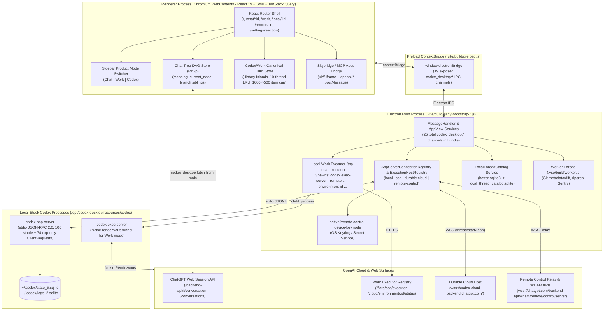

# ChatGPT Desktop Full-Stack Architecture Map (Recalibrated)

> **Target Binary Inspected**: ChatGPT Desktop (Linux/Electron Packaging of `@openai/codex-electron`)
> **Package Version**: `26.1103.32239` (`codexBuildNumber: 25471`, `codexBuildFlavor: "prod"`; revalidated 2026-11-09)
> **Renderer Entry**: `webview/index.html` with hashed renderer assets; exact chunk names are build artifacts and are not treated as a stable contract.
> **Main Process Bundle**: `.vite/build/main.js` + `.vite/build/early-bootstrap-920-a204a41244c4b913.js` (~4.58 MB) + `.vite/build/early-bootstrap-339-10eda6b28d12299c.js` (~855 KB) + `.vite/build/early-bootstrap-133-3bca9e88e9a413b4.js` (~357 KB) + `.vite/build/worker.js` (~1.20 MB)
> **Bundled Native Runtime**: `/opt/codex-desktop/resources/codex` (`codex-cli 0.167.0-alpha.3.2`, ~96.9 MB ELF binary)
> **Bundled Sidecars (`app.asar.unpacked`)**: `codex-command-runner`, `codex-windows-sandbox-setup`, `native/sparkle.node`, `native/remote-control-device-key.node`, `better-sqlite3`, `node-pty`
> **Inspection Tool**: [`tools/reverse/inspect_chatgpt_desktop.py`](tools/reverse/inspect_chatgpt_desktop.py) (`--summary`, `--ipc`, `--endpoints`, `--sqlite-schemas`, `--css-tokens`, `--plugins`, `--evidence-report`)

---

## 0. Evidence Confidence & Support Classification Model

Every technical claim in `docs/reverse/*.md` is tagged using two orthogonal axes:

### A. Evidence Confidence Tags (How we know it)
- **`PUBLIC_DOC`**: Documented in official OpenAI public documentation (`platform.openai.com`, `developers.openai.com`, `help.openai.com`).
- **`PUBLIC_SOURCE`**: Verified in open-source `openai/codex` source or generated directly by the stock `codex app-server generate-json-schema` CLI (`codex-cli 0.167.0-alpha.3.2`).
- **`LIVE_OBSERVED`**: Directly observed in a running ChatGPT Desktop process, DOM/computed styles, or runtime state.
- **`LIVE_CALLED`**: Directly invoked/verified against a live local runtime or endpoint during inspection.
- **`STATIC_BUNDLE`**: Extracted read-only from the installed `app.asar` bundle (`.vite/build/*.js`, `webview/assets/*.js`, `webview/assets/*.css`).
- **`LOCAL_SCHEMA`**: Extracted read-only (`?mode=ro`) from local `~/.codex/*.sqlite` / `*.db` DDL (`sqlite_master`).
- **`COMMUNITY_CORROBORATED`**: Corroborated by independent third-party engineering reports, never treated as a public contract.
- **`INFERRED`**: Architectural synthesis derived from multiple lower-level observations; explicitly separated from raw facts.
- **`UNKNOWN`**: Not determinable from available machine evidence without server-side source or live account gating.

### B. Support & Contract Classifications (What we may depend on)
- **`PUBLIC_SUPPORTED`**: Stable public API or open-source stock `codex app-server` protocol (`106` stable `ClientRequest`, `10` stable `ServerRequest`, `86` `ServerNotification`). Safe as a primary dependency.
- **`EXPERIMENTAL_STOCK_SCHEMA`**: Present only in stock `codex app-server generate-json-schema --experimental` (`74` experimental-only `ClientRequest`, `1` experimental-only `ServerRequest`; current examples include `thread/items/read`, `thread/timeline/list`, `remoteControl/*`, queue/realtime/search families, and `currentTime/read`). Safe for optional/adapter-isolated native features. `thread/turns/list` and `thread/items/list` are stable in the current generated schema.
- **`PRIVATE_WEB_SESSION`**: First-party ChatGPT web-session endpoints (`/backend-api/*`). Requires browser/session cookies + Sentinel/Turnstile anti-bot headers; **never** a default core dependency.
- **`PRIVATE_INTERNAL_SERVICE`**: First-party internal Desktop/Cloud services (`/wham/*`, `/flora/cca/executor`, `wss://codex-cloud-backend.chatgpt.com/`, `wss://chatgpt.com/backend-api/wham/remote/control/server`, `thread/startAeon`, `thread/environmentReady`). Treated as reference architecture only unless explicitly unlocked by a future compatibility adapter.
- **`INTERNAL_ELECTRON_IPC`**: Internal Electron `ipcMain`/`ipcRenderer` channels (`codex_desktop:*`).

---

## 1. Executive Architectural Summary: Shared Shell vs Distinct Runtimes

ChatGPT Desktop (`26.1103.32239`, build `25471`) is a **unified multi-mode Electron shell** built on code originating from the `@openai/codex-electron` workspace (`STATIC_BUNDLE`).

### Critical Distinction: Shared Presentation Shell != Identical Runtime Model
While **Chat**, **Work**, and **Codex** share the **application shell, sidebar navigation, composer chrome, and renderer item/slot virtualization infrastructure**, they do **not** share a single backend source of truth (`STATIC_BUNDLE`, `LOCAL_SCHEMA`):

| Product Mode | Canonical Source of Truth | Execution / Transport Runtimes | Local SQLite Role | Evidence & Support |
|---|---|---|---|---|
| **Chat** (`/chat/:id`) | Cloud **Conversation Tree DAG** (`MrGp`: `mapping`, `current_node`, `parent`, `children`) on `/backend-api/f/conversation` | HTTPS SSE stream (`/backend-api/f/conversation` + `/backend-api/f/conversation/prepare`) | Metadata index only (`local_thread_catalog.sqlite` with `source_kind = 'chatgpt'`, `conversation_origin IS NOT 'tpp'`) | `STATIC_BUNDLE`, `LOCAL_SCHEMA` / `PRIVATE_WEB_SESSION` |
| **Work** (`/work`, everyday/task mode) | **Multi-runtime product orchestration** across 4 execution paths (see Section 2.2) | 1. Local `codex app-server` (`STEPS_PROSE` + `<app-context>### Non-technical UI`) 2. Durable Cloud Host (`wss://codex-cloud-backend.chatgpt.com/`, `thread/startAeon`) 3. Local Work Executor (`codex exec-server --remote ... --environment-id ...` over Noise rendezvous + `POST /flora/cca/executor` + `thread/environmentReady`) 4. Cloud `/backend-api/f/conversation` with `conversation_origin = 'tpp'` + `submitChatGPTLocalFunctionResult` | Indexed in `local_thread_catalog.sqlite` (`source_kind = 'local' \| 'cloud' \| 'chatgpt'` with `conversation_origin = 'tpp'`); local threads in `state_5.sqlite` | `STATIC_BUNDLE`, `LOCAL_SCHEMA`, `PUBLIC_SOURCE` (`exec-server` CLI) / Mixed `PUBLIC_SUPPORTED` + `PRIVATE_INTERNAL_SERVICE` |
| **Codex** (`/local/:id`, `/remote/:id`) | **Linear Turn/Item History** (`canonical` history islands + `thread/turns/list`, `thread/items/list`, `thread/timeline/list`) owned by `codex app-server` | 1. Local child `codex app-server` (stdio JSONL) 2. SSH remote `codex app-server` (OpenSSH stdio) 3. Durable Cloud Host (`wss://codex-cloud-backend.chatgpt.com/`) 4. Official Remote Control relay (`wss://chatgpt.com/backend-api/wham/remote/control/server`) | Full runtime state in `~/.codex/state_5.sqlite` (owned by Rust `codex app-server`); cross-host sidebar catalog in `local_thread_catalog.sqlite` | `PUBLIC_SOURCE`, `STATIC_BUNDLE`, `LOCAL_SCHEMA`, `LIVE_OBSERVED` / `PUBLIC_SUPPORTED` + `EXPERIMENTAL_STOCK_SCHEMA` |

---

## 2. Deep-Dive: How Chat, Work, and Codex Actually Relate

### 2.1 Why `STEPS_PROSE` Does Not Mean Stock `app-server` Is the Cloud Chat Backend
A critical correction to earlier analysis (`ADR-031` -> superseded by `ADR-032`):
In `.vite/build/early-bootstrap.js @271830` and `.vite/build/early-bootstrap-920-a204a41244c4b913.js @2190585, @4400493`:
- `conversationDetailMode` is a setting with enum `["STEPS_PROSE", "STEPS_COMMANDS", "STEPS_EXECUTION"]` (default `"STEPS_COMMANDS"`).
- When an account's `workModeAccessByAccount` policy is `"everyday"` (or the user selects `"STEPS_PROSE"`), `conversationDetailMode.effective` evaluates to `"STEPS_PROSE"`.
- In `.vite/build/early-bootstrap-920 @4400493` and `.vite/build/early-bootstrap-339 @780000..792000`, `c = ("STEPS_PROSE" === a.effective)` sets `includeProseDetailLevelInstructions: true`.
- Function `a7` (`early-bootstrap-339 @787500`) uses `includeProseDetailLevelInstructions` to inject constant `a2` (`### Non-technical UI`) into the `<app-context>...</app-context>` block passed as `developerInstructions` to Codex/Work agent threads:
  - It instructs the Codex/Work agent: *"The user has requested a non-technical UI. The app will take care of aspects of this, such as hiding bash tool outputs and similar. Prefer non-technical language when conversing with the user... When writing code to perform non-coding tasks--such as writing and running python to build slide artifacts--avoid mentioning or citing these intermediate code items. Just focus on outputs."*
- **Architectural Consequence**:
  1. `STEPS_PROSE` is a **Work/Codex agent presentation & developer-instruction detail mode**, **not** proof that stock `codex app-server` is the backend for standard ChatGPT Cloud Chat (`/backend-api/f/conversation`).
  2. Standard ChatGPT Cloud Chat (`/chat/:conversationId`) uses the `MrGp` conversation tree DAG and `/backend-api/f/conversation`.
  3. Per `AGENTS.md` Rule #1 (*"Do not copy or fork Codex system prompts into the client"*), `Codex-Native-Unoffical` must **not** copy the proprietary `a2` (`### Non-technical UI`) prompt into the client.

### 2.2 The Four Execution Paths of Work Mode (`STATIC_BUNDLE`, `PUBLIC_SOURCE`)
Reverse analysis of `early-bootstrap-920` (`@732731`, `@1168648`, `@1644000..1666500`, `@4400493`, `@4477500`) proves that **Work Mode** is not simply `"Chat + app-server"`, nor is it a single runtime. It orchestrates four distinct paths:

1. **Local Work Agent Threads (`hostId = "local"`, `codex app-server`)**:
   - Uses local `codex app-server` with `conversationDetailMode = "STEPS_PROSE"`, `writing_blocks` feature gate, `openai_artifact_template_picker` MCP server (`artifact-template-picker/server.mjs`), and `mcp__codex_app__load_workspace_dependencies`.
2. **Durable Cloud Work Agent Threads (`hostId = "durable"`, `wss://codex-cloud-backend.chatgpt.com/`)**:
   - Connects over WebSocket to `wss://codex-cloud-backend.chatgpt.com/` (`X-OpenAI-Product-Sku: "aeon"`).
   - Starts threads using the **cloud-only** RPC `"thread/startAeon"` (`early-bootstrap-920 @1168648`: `method: "durable" === k && "aeon" === E ? "thread/startAeon" : "thread/start"`).
   - Lists cloud threads with originators `["codex_cloud", "codex_work_cca"]` (`@4402650`).
3. **Local Work Executor (`tpp-local-executor` -> `codex exec-server`)**:
   - Implemented by `class kj` (`logger = "tpp-local-executor"`, `early-bootstrap-920 @1644018..1666262`).
   - Persists an installation UUID in `.codex-tpp-local-executor-installation-id` (`@1645522`).
   - Registers the desktop computer with OpenAI Cloud via `POST /flora/cca/executor` (`DELETE /flora/cca/executor` to clear) and polls readiness via `GET /cloud/environment/{environmentId}/status` (`@1645600..1653400`).
   - Spawns `/opt/codex-desktop/resources/codex exec-server --concurrent-requests 32 --remote <url> --environment-id <environmentId>` with `CODEX_INTERNAL_ORIGINATOR_OVERRIDE="codex_work_desktop"` (`@1658200`), which establishes an outbound Noise-protocol rendezvous tunnel (`noise_event="rendezvous_connection"`).
   - Notifies the Durable Cloud Host that the local environment and its plugin capability roots are ready via the cloud-extension RPC `thread/environmentReady` (`@1647000`).
4. **Cloud ChatGPT Conversations with `conversation_origin === "tpp"`**:
   - Stored on `/backend-api/f/conversation` (`source_kind = "chatgpt"`) with `conversation_origin = "tpp"`.
   - Indexed in `local_thread_catalog.sqlite` where SQL queries explicitly filter `"tpp" === e.conversationOrigin ? "AND conversation_origin = 'tpp'" : "AND conversation_origin IS NOT 'tpp'"` (`@732731`) to separate Work (`tpp`) conversations from regular Chat (`non-tpp`) conversations in the sidebar.
   - Bridges local function/browser execution back to ChatGPT via `submitChatGPTLocalFunctionResult`.

---

## 3. Process Topology & IPC Inventory (`DISCOVERED` vs `PRELOAD_EXPOSED`)

 Running `python3 tools/reverse/inspect_chatgpt_desktop.py --evidence-report` establishes the exact boundary between preload-exposed renderer IPC channels and internal main/worker IPC channels:

| IPC Category | Count | Channels | Evidence & Classification |
|---|---|---|---|
| **Preload-Exposed Renderer Channels** (`.vite/build/preload.js`) | **19** | Includes `message-for-view`, `message-from-view`, `connect-app-host`, `connect-git-worker`, `get-initial-sidebar-bootstrap`, `get-build-flavor`, `get-system-theme-variant`, `show-context-menu`, `start-file-drag`, `start-link-drag`, and chunked-message/MCP sandbox bridges. | `STATIC_BUNDLE`, `LIVE_OBSERVED` / `INTERNAL_ELECTRON_IPC` |
| **Main/Internal-Only IPC Strings** (`.vite/build/early-bootstrap-*.js`, `main.js`, workers, specialized preloads) | **6** | `browser-page-event`, `browser-sidebar-runtime-message`, `check-for-updates`, `get-browser-annotation-api-policy`, `get-browser-webmcp-policy`, `mcp-app-sandbox-guest-message` | `STATIC_BUNDLE` / `INTERNAL_ELECTRON_IPC` |
| **Total Static `codex_desktop:*` Strings** | **25** | All 25 channels above; the extractor reports per-channel bundle provenance. | `STATIC_BUNDLE` |

---

## 4. Stock `codex app-server` Schema vs Desktop Bundle RPC Surface

Cross-checking the bundled `/opt/codex-desktop/resources/codex app-server generate-json-schema` (`codex-cli 0.167.0-alpha.3.2`, `PUBLIC_SOURCE`) against static RPC strings in `app.asar` (`STATIC_BUNDLE`):

| Protocol Direction / Surface | Stock Stable Schema (`PUBLIC_SOURCE`) | Stock `--experimental` Only (`PUBLIC_SOURCE`) | Total Stock Schema (`0.167.0-alpha.3.2`) | Matched in Desktop ASAR (`STATIC_BUNDLE`) | ASAR-Only (Not in Local Stock Schema) |
|---|---|---|---|---|---|
| `ClientRequest` (Client -> Server) | **106** | **74** | **180** | **129** (`88` stable + `41` experimental) | **28 conservative unmatched strings across all RPC-like categories**, including genuine cloud extensions (`thread/startAeon`, `thread/environmentReady`) and static-match noise; inspect per-symbol evidence. |
| `ServerRequest` (Server -> Client) | **10** | **1** | **11** | **7** stock methods matched in ASAR | Included in the conservative unmatched column above |
| `ServerNotification` (Server -> Client) | **86** | **0** | **86** | **70** | `0` |
| `ClientNotification` (Client -> Server) | **1** (`initialized`) | **0** | **1** | **1** (`initialized`) | `0` |

---

## 5. Companion Reverse-Analysis Documents

1. **[`UI_REFERENCE.md`](docs/reverse/UI_REFERENCE.md)** — Design tokens, CSS layer cascade, typography, layout dimensions, and component anatomy with evidence tags and current `Codex-Native-Unoffical` comparison.
2. **[`DATA_FLOW.md`](docs/reverse/DATA_FLOW.md)** — State stores, all history hydration paths (`limit: 5`, `limit: 2`, `limit: 28/30/100`, `limit: 500`, `1000 -> 500` gated eviction, `10`-thread LRU), Chat `MrGp` DAG, and Work multi-runtime data flows.
3. **[`LOCAL_STORAGE_MAP.md`](docs/reverse/LOCAL_STORAGE_MAP.md)** — Read-only SQLite DDL schemas (`state_5.sqlite`, `logs_2.sqlite`, `local_thread_catalog.sqlite`, `codex_dev.db`), populated vs schema-only tables, and storage ownership boundaries.
4. **[`NETWORK_SURFACES.md`](docs/reverse/NETWORK_SURFACES.md)** — `DISCOVERED` vs `LIVE` vs `FEATURE_GATED` classification of `/backend-api/*`, `/wham/*`, `/flora/cca/executor`, Durable Cloud WebSocket, and Remote Control relay.
5. **[`CHATGPT_COMPATIBILITY.md`](docs/reverse/CHATGPT_COMPATIBILITY.md)** — Honest comparison of Route A (`OpenAIResponsesBackend`), Route B (`ChatGPTCompatibilityBackend`), and Route C (`CodexBackend` prose agent).
6. **[`PLUGIN_HOST_MAP.md`](docs/reverse/PLUGIN_HOST_MAP.md)** — Marketplace schema, 17 bundled plugins, 33 skills, MCP servers, and Skybridge (`ui://` iframe host) with evidence tags.
7. **[`CODEX_INTEGRATION_MAP.md`](docs/reverse/CODEX_INTEGRATION_MAP.md)** — Stock `codex app-server` schema vs ASAR RPC surface, `thread/startAeon` cloud isolation, and the 8-layer stratification of Official Remote Control vs Direct Host.
8. **[`ADOPTION_MATRIX.md`](docs/reverse/ADOPTION_MATRIX.md)** — Calibrated 8-column comparison against actual `Codex-Native-Unoffical` `HEAD`, 6 adoption categories (`ADOPT_PATTERN`, `ADAPT_NATIVE`, `COPY_MEASURED_BEHAVIOR`, `KEEP_OUR_ADVANTAGE`, `DO_NOT_ADOPT`, `RESEARCH_MORE`), current code-review debt items, and the formal `PREVIOUS CLAIM -> NEW FINDING` correction table.
