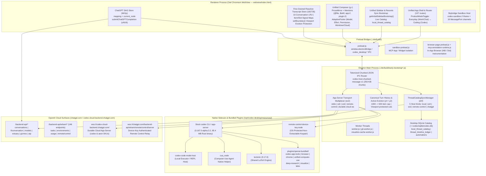

# ChatGPT Desktop (`26.1103.32239` / Build `25471`) — Full-Stack Architecture Map

> **Provenance & Clean-Room Notice**
> - **Reference Build**: `chatgpt-26.1103.32239-amd64.deb` (`package.json`: `"name": "openai-codex-electron"`, `"productName": "Codex"`, `"version": "26.1103.32239"`, `"codexBuildNumber": "25471"`, `"codexBuildFlavor": "prod"`).
> - **Runtime Engine**: `@oai/electron` (`npm:@oai/owl-linux-x64@157.0.8103.39` — OpenAI's custom Chromium/Electron fork "Owl").
> - **Bundle Integrity**: `/opt/codex-desktop/resources/app.asar` (`757,450,773` bytes, `19,954` files, `sha256: 63106325f6c5fb668e57323ece7c1b29d617877132096e9b856e7606b10c68fe`), verified byte-for-byte identical to the upstream `.deb` package (`dpkg --verify chatgpt` clean).
> - **Clean-Room Policy**: All findings in `docs/reverse/*.md` are behavioral, schema, protocol, and architectural descriptions derived for Apache-2.0 clean-room engineering. No proprietary code or assets are copied into the repository.

---

## 1. Executive Architecture Discovery: One Unified Codebase for Chat, Work, and Codex

The single most important architectural fact uncovered in `26.1103.32239` is that **ChatGPT Desktop is not a Chat app with a bolted-on Codex plugin, nor is it a standalone Codex app**. Instead:

1. **Internal Monorepo Identity**: The application is built from `codex/codex-apps/electron` (`openai-codex-electron`) running on OpenAI's custom **Owl (`157.0.8103.39`)** Chromium/Electron runtime.
2. **Unified Shell, Mode-Parameterized Presentation**:
   - **Chat ("Everyday")**, **Work ("Everyday + Cloud/Local Executor + Writing Blocks + In-App Browser")**, and **Codex ("Coding")** all share the **exact same App Shell, Router, Sidebar Catalog (`local_thread_catalog`), Composer (`g.r`), and Fine-Grained Transcript Store (`182735.d3d917f28d.js`)**.
   - The experience switches dynamically via two orthogonal axes:
     - **Product Surface / Sidebar Mode (`sidebarProductMode`)**: `"work"` (Everyday / Chat + Work) vs `"codex"` (Coding), controlled by user access gates `tr()` (`codexLocalAccess`, `workCloudAccess`, `workLocalAccess`) and the header `ProductModeToggle` (`height: 32px`).
     - **Conversation Detail Mode (`conversationDetailMode`)**:
       - `"STEPS_PROSE"` (Everyday / Work default): Condenses tool calls, file reads, and searches into prose summaries (`usesCondensedPresentation`), activates `writing_blocks` and `includeProseDetailLevelInstructions`, and hides raw shell/diff noise unless expanded.
       - `"STEPS_COMMANDS"` (Coding / Codex default): Renders full command execution cards, unified diffs, terminal drawers, and git/worktree controls.
       - `"STEPS_EXECUTION"`: Full raw execution trace mode.
3. **Dual Conversation Engine Under One UI**:
   - **Cloud ChatGPT Conversations (`source_kind = "chatgpt"`, `conversation_origin = "chatgpt" | "work" | "tpp"`)**: Backed by `/backend-api/f/conversation` (SSE) + `/backend-api/conversations` REST catalog sync + `MrGp` message-tree DAG (`mapping` + `current_node`).
   - **App-Server / Agent Threads (`host_kind = "local" | "ssh" | "wsl" | "remote-control"` or Durable Cloud Host `wss://codex-cloud-backend.chatgpt.com/`)**: Backed by `codex app-server` JSON-RPC 2.0 (`thread/*`, `turn/*`, `item/*`) + canonical turn history islands (`turnHistory.kind === "canonical"`).
   - **Bridge Between Them**: Both populate the same SQLite table (`~/.codex/sqlite/codex.db` -> `local_thread_catalog`) and both project into the same renderer transcript item/slot store!

---

## 2. System Topology & Process Boundary Diagram

---

## 3. Process, Worker, and Sidecar Inventory

### 3.1 Main Process & Worker Bundles (`.vite/build/` inside `app.asar`)

| File | Size | Architectural Role | Classification |
| :--- | ---: | :--- | :--- |
| `.vite/build/early-bootstrap.js` | 1.9 KB | Entry point (`package.json` `"main"`). Configures crash reporter, V8 flags, and loads the main bootstrap chunks. | `LOCAL_IMPLEMENTATION_DETAIL` |
| `.vite/build/early-bootstrap-920-C1369sJ4.js` | 4.86 MB | Core main-process orchestrator: `ThreadCatalogSyncManager` (`ehf`), SQLite (`codex.db`) migrations & queries, `app-server` transport multiplexer (`evZ`), canonical turn history & active eviction (`yV`/`yZ`), window lifecycle, native menus, deep links (`codex://`, `chatgpt://`), and cloud REST proxy. | `LOCAL_IMPLEMENTATION_DETAIL` |
| `.vite/build/early-bootstrap-B6a536G_.js` | 699 KB | Secondary bootstrap module: OS integration, tray/menu bar, global hotkey window, updater, and authentication session management. | `LOCAL_IMPLEMENTATION_DETAIL` |
| `.vite/build/main-DY03G_5y.js` | 29.8 KB | Application window creation and Owl browser-session wiring. | `LOCAL_IMPLEMENTATION_DETAIL` |
| `.vite/build/worker.js` | 309 KB | Background utility worker thread for CPU-bound JSON/search/indexing tasks off the main Electron event loop. | `LOCAL_IMPLEMENTATION_DETAIL` |
| `.vite/build/git-worker-Bt1_yQbN.js` + `git-worker.js` | 1.48 MB | Dedicated Git worker thread (`git-worker`) that runs `git status`, `git diff`, worktree inspection, branch/PR status checks (`x-codex-git-source`), and hunk parsing without blocking main or renderer threads. | `LOCAL_IMPLEMENTATION_DETAIL` |
| `.vite/build/visualize-cache-worker.js` | 4.1 KB | Worker that caches and validates `visualize` chart/widget assets. | `LOCAL_IMPLEMENTATION_DETAIL` |

### 3.2 Preload Bridges (`.vite/build/`)

| File | Size | Exposed Surface & Security Role | Classification |
| :--- | ---: | :--- | :--- |
| `.vite/build/preload.js` | 14.3 KB | Exposes `window.electronBridge` (`contextIsolation: true`) over 22 `codex_desktop:*` IPC channels, plus `getInitialSidebarBootstrap()` (synchronous IPC for 0-ms first-frame sidebar rendering) and `getSentryInitOptions()`. | `LOCAL_IMPLEMENTATION_DETAIL` |
| `.vite/build/sandbox-preload.js` | 1.4 KB | Minimal preload for `codex-sandbox://` skybridge iframes; bridges only postMessage / `MessagePort` channels for sandboxed widgets and MCP apps. | `LOCAL_IMPLEMENTATION_DETAIL` |
| `.vite/build/browser-page-preload.js` | 3.5 KB | Injected into in-app browser (`persist:codex-browser-app`) tabs to support element picking, accessibility snapshots, and Sign-in-with-ChatGPT (`siwc`) detection. | `LOCAL_IMPLEMENTATION_DETAIL` |
| `.vite/build/mcp-annotation-runtime.js` | 65.5 KB | Visual DOM/region annotation overlay runtime injected into browser/preview surfaces (`Kwny`: `diff`, `browser`, `pdf`, `artifact_annotation`, `artifact_comment`). | `LOCAL_IMPLEMENTATION_DETAIL` |

### 3.3 Native Sidecar Binaries & Node Addons (`resources/` & `app.asar.unpacked/`)

| Binary / Addon | Size | Role & Invocation Mechanism | Classification |
| :--- | ---: | :--- | :--- |
| `resources/codex` | 85.4 MB | Stock Rust `codex` CLI & `codex app-server` (`codex-linux-x64 0.167.0-alpha.3.2`). Spawned via `codex app-server --analytics-default-enabled` over stdio JSONL. | `PUBLIC_SUPPORTED` |
| `resources/codex-code-mode-host` | 5.2 MB | Native sidecar host for Code Mode / `node_repl` / local execution (`CODEX_CODE_MODE_HOST`). | `LOCAL_IMPLEMENTATION_DETAIL` |
| `resources/cua_node` | 6.8 MB | Computer-Use Agent native helper binary (`unified-computer-use` plugin / screen & input automation). | `PLATFORM_NATIVE` |
| `resources/rg` | 4.6 MB | Bundled `ripgrep` binary injected into `PATH` for fast workspace search. | `PUBLIC_SUPPORTED` |
| `resources/tectonic` | 42.3 MB | Bundled Tectonic `0.17.0` TeX engine exposed via `CODEX_TECTONIC_PATH` to the `latex` plugin and built-in PDF/LaTeX previewer. | `LOCAL_IMPLEMENTATION_DETAIL` |
| `resources/artifact-template-picker` | 4.5 MB | Native helper for office/document artifact template selection (`$documents` / `$presentations`). | `LOCAL_IMPLEMENTATION_DETAIL` |
| `resources/dictation-ducking` | 21 KB | Audio ducking helper during push-to-talk / realtime voice dictation. | `PLATFORM_NATIVE` |
| `resources/native/remote-control-device-key.node` | 150 KB | Native N-API addon that generates and signs with an OS-protected non-extractable hardware keypair (`createDeviceKey("allow_os_protected_nonextractable")`) for `remote-control` WebSocket authentication. | `PRIVATE_COMPATIBILITY` |
| `resources/native/hid-topology-watcher.node` + `@worklouder/wl-device-kit` | 112 KB + prebuilds | Native USB/HID watcher for physical macro pad / rotary encoder hardware (`ACT06`–`ACT12` keycaps: `FAST`, `APPR`, `REJ`, `SPLIT`, `MIC`, `CODEX`, `YOLO`, `YEET`). | `PLATFORM_NATIVE` |
| `better-sqlite3/build/Release/better_sqlite3.node` | 1.98 MB | Synchronous native SQLite driver used in the main process for `~/.codex/sqlite/codex.db`. | `LOCAL_IMPLEMENTATION_DETAIL` |
| `node-pty/build/Release/pty.node` | 39 KB | Native pseudo-terminal addon used for integrated terminal drawer sessions (`terminal-create`, `terminal-write`, `terminal-resize`). | `PLATFORM_NATIVE` |
| `@parcel/watcher-linux-x64-glibc/watcher.node` | 523 KB | Native filesystem watcher for live project tree and diff invalidation. | `PLATFORM_NATIVE` |

---

## 4. Renderer <-> Main Process IPC Architecture

### 4.1 Complete `codex_desktop:*` IPC Channel Inventory (26 Channels)

| IPC Channel | Direction | Sync/Async | Purpose |
| :--- | :--- | :--- | :--- |
| `codex_desktop:get-initial-sidebar-bootstrap` | Renderer -> Main | **Sync (`sendSync`)** | Returns cached sidebar project/thread bootstrap synchronously before first React paint so the sidebar never flashes empty on startup. |
| `codex_desktop:message-from-view` | Renderer -> Main | Async (`invoke`/`send`) | Primary multiplexed command/RPC envelope from renderer to main process (`1,595` message `case` types). |
| `codex_desktop:message-for-view` | Main -> Renderer | Async (`webContents.send`) | Primary multiplexed state/event push from main process to renderer (`changes`, `thread-stream-state-changed`, `inbox-items-changed`, etc.). |
| `codex_desktop:HostToWebViewChunkedMessage` | Main -> Renderer | Async | Chunked transport envelope (`codex-host-chunked-message-v1`) for payloads exceeding 256 KiB. |
| `codex_desktop:fetch` | Renderer -> Main | Async | Proxies authenticated REST requests (`/backend-api/*`, `/wham/*`) through main process with account/device headers. |
| `codex_desktop:CancelFetch` | Renderer -> Main | Async | Aborts an in-flight `codex_desktop:fetch` request by `requestId`. |
| `codex_desktop:fetch-stream` | Renderer -> Main | Async | Initiates an SSE or newline-delimited JSON stream (`/backend-api/f/conversation`, etc.) proxied via main process. |
| `codex_desktop:CancelFetchStream` | Renderer -> Main | Async | Cancels an active `codex_desktop:fetch-stream`. |
| `codex_desktop:FetchStreamEvent` | Main -> Renderer | Async | Pushes incremental SSE/stream chunks to the renderer. |
| `codex_desktop:FetchStreamComplete` | Main -> Renderer | Async | Signals normal completion of a `fetch-stream`. |
| `codex_desktop:FetchStreamError` | Main -> Renderer | Async | Signals error termination of a `fetch-stream`. |
| `codex_desktop:FileAttachmentRead` | Renderer -> Main | Async | Reads local file bytes/metadata for composer attachment upload. |
| `codex_desktop:show-context-menu` | Renderer -> Main | Async | Opens native OS context menu at cursor coordinates. |
| `codex_desktop:trigger-sentry-test` | Renderer -> Main | Async | Triggers test crash/error report for diagnostics. |
| `codex_desktop:get-sentry-init-options` | Renderer -> Main | **Sync (`sendSync`)** | Returns build metadata and telemetry configuration at startup. |
| `codex_desktop:copy- diagnostics` / `log-*` | Renderer -> Main | Async | Structured logging and diagnostic bundle export. |

### 4.2 Tokenized Chunked JSON Framing (`codex-host-chunked-message-v1`)

To prevent large state snapshots or diffs from stalling Chromium's structured-clone IPC serializer, the main process implements a two-stage optimization in `early-bootstrap-920`:

1. **String-Table Tokenization (`tokenizeStrings`)**:
   - Repeated strings (file paths, thread IDs, item types, status enums) in `changes` payloads are deduplicated into a compact string table before serialization.
2. **256 KiB Chunked Envelope (`codex-host-chunked-message-v1`)**:
   - When a serialized JSON message exceeds **262,144 bytes (`256 KiB`)**, the sender splits the UTF-8 string into `256 KiB` chunks and transmits them over `codex_desktop:HostToWebViewChunkedMessage` with `{ __codexChunkedMessage: "codex-host-chunked-message-v1", messageId, chunkIndex, totalChunks, chunk }`.
   - The receiver reassembles chunks in a bounded map (`maxActiveMessages = 32`, `maxTotalBufferedChars = 64 MiB`) and parses the JSON only after the final chunk arrives.

---

## 5. How Chat, Work, and Codex Share & Specialize the Platform

| Dimension | Chat ("Everyday") | Work ("Everyday + Executor") | Codex ("Coding") |
| :--- | :--- | :--- | :--- |
| **Product Mode (`sidebarProductMode`)** | `"work"` | `"work"` | `"codex"` |
| **Conversation Origin (`conversation_origin`)** | `"chatgpt"` | `"work"` or `"tpp"` (Third-Party/Local Executor) | `null` (App-Server native) or `"aeon"` |
| **Detail Mode (`conversationDetailMode`)** | `"STEPS_PROSE"` | `"STEPS_PROSE"` (toggleable to `"STEPS_COMMANDS"`) | `"STEPS_COMMANDS"` (toggleable to `"STEPS_PROSE"` or `"STEPS_EXECUTION"`) |
| **Primary Runtime** | Cloud `/backend-api/f/conversation` | Cloud `/backend-api/f/conversation` + Local Executor (`codex-code-mode-host` / `cua_node` / `browser`) OR Durable Cloud `thread/startAeon` | Local/Remote `codex app-server` (`stdio`, `ssh`, `wsl`, `remote-control`, or Durable Cloud `wss://codex-cloud-backend.chatgpt.com/`) |
| **Catalog Storage** | `local_thread_catalog` (`host_kind = "chatgpt"`) | `local_thread_catalog` (`host_kind = "chatgpt"` or `"local"`) | `local_thread_catalog` (`host_kind = "local" | "ssh" | "wsl" | "remote-control"`) |
| **Project Model** | Cloud Gizmo Projects (`g-p-*`) synced with local projects via `codex_unified_projects` | Shared Unified Projects (`local` root + `chatGptBacking.projectId`) | Workspace root directories (`state_5.sqlite` `projects` + `project_roots`) optionally backed by `g-p-*` |
| **Right-Hand Panels** | Artifacts / Writing Blocks / Canvas / Citations | In-App Browser (`persist:codex-browser-app`), Deliverables, Office/PDF Preview | Git Diff Inspector, Review Drawer, Integrated Terminal (`node-pty`), Command Output |

---

## 6. Key Architectural Takeaways for `Codex-Native-Unoffical`

1. **Do Not Split into Separate Apps**: Official ChatGPT Desktop proves that Chat, Work, and Codex belong in a **single application shell** with a shared sidebar catalog, shared composer, and shared conversation viewport, parameterized by **Experience Mode** (`Everyday/Prose` vs `Coding/Commands`) and **Conversation Backend Adapter** (`AppServerAdapter` vs `ChatGptCloudAdapter`).
2. **Synchronous/Instant Sidebar Bootstrap**: The official app avoids startup layout shift by reading a lightweight SQLite catalog (`local_thread_catalog`) before first paint (`getInitialSidebarBootstrap`), then running background sync (`ThreadCatalogSyncManager`).
3. **Host-Owned Canonical History Islands + Viewport-Protected Eviction**: The main process (`codex-native-host` in our stack) should own canonical turn/item islands and evict active history above 1,000 items down to 500 items **only above the renderer's reported viewport boundary (`oldestProtectedTurnId`, `firstProtectedItemId`)**.
