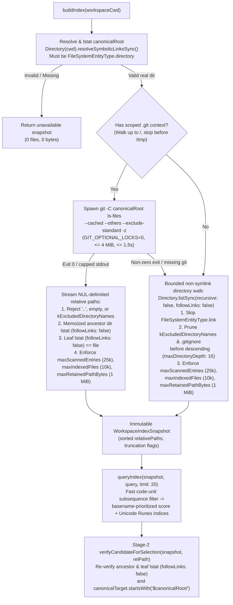

# App-Owned Bounded Local Workspace File Index vs Stock `fuzzyFileSearch`: Containment, Ignore Semantics, and Scale Evidence

Date: 2026-11-10
Status: Complete (`PUBLIC_SOURCE_0E6F153` + `STATIC_BUNDLE` + `DISPOSABLE_LIVE_PROBE`)
Scope: F28B independent evaluation of an app-owned bounded local workspace file index (`git ls-files` with `GIT_OPTIONAL_LOCKS=0` + non-symlink `Directory.listSync(followLinks: false)` fallback + memoized ancestor/leaf `lstat` + Stage-2 selection verification) compared side-by-side against stock `codex app-server` `fuzzyFileSearch` across installed `0.167.0-alpha.3.2`, official public stable `0.167.0`, Desktop-train public alpha `0.167.0-alpha.4.1`, higher public alpha `0.169.0-alpha.7`, upstream `openai/codex` (`0e6f153732cc12bb8d82672c05b4d4840268af33`), and Official Codex Desktop (`26.1103.60933`, build `25894`).

---

## 1. Executive Summary

1. **Why Stock `fuzzyFileSearch` Cannot Satisfy Strict Traversal Containment (`PUBLIC_SOURCE_0E6F153` + `DISPOSABLE_LIVE_PROBE`)**:
   - In [`docs/reverse/WORKSPACE_FILE_SEARCH_EVIDENCE.md`](WORKSPACE_FILE_SEARCH_EVIDENCE.md#L139-L154) (F23B), we established that client post-filtering of stock `fuzzyFileSearch` results can filter what the UI renders, but **cannot** prevent the stock `codex app-server` child process from walking external symlinked directories beforehand.
   - Upstream source inspection at `0e6f153732cc12bb8d82672c05b4d4840268af33` (`codex-rs/file-search/src/lib.rs:428-514`) confirms why: `walker_worker` constructs `ignore::WalkBuilder` with `.hidden(false)` (line `445`), `.follow_links(true)` (line `447`), and `.require_git(true)` (line `450`), and pushes every discovered path into `nucleo::Injector` (`lines 487-501`) with **no cap on `scanned_file_count`**.
   - Across all 4 measured stock binaries (`0.167.0-alpha.3.2`, `0.167.0`, `0.167.0-alpha.4.1`, and `0.169.0-alpha.7`), calling `fuzzyFileSearch` on our adversarial fixture (`W2`) walked into an external sibling directory (`outside_secret_zone`, containing `2,001` external files) via both an untracked directory symlink (`link_to_outside_dir`) and a post-commit swapped ancestor symlink (`tracked_dir_turned_symlink`), returning `2/2` external matches for `"outside_secret"` and `50/50` external matches for `"external_escape"`, plus `7/7` `.git/` metadata matches for `"HEAD"`.
   - Furthermore, because `codex-rs/file-search/src/lib.rs:450` sets `.require_git(true)`, stock `fuzzyFileSearch` in a **non-Git workspace** (`W5_large_nongit`) completely ignores the workspace `.gitignore` file and walks `node_modules/` and external symlinks, returning `secret_key.secret` (`1` match), `50/50` `node_modules/pkg_*/nm_199.js` matches, and `50/50` `link_to_outside_dir/external_bulk/external_escape_*.txt` matches on all 4 binaries.

2. **Two-Primitive App-Owned Local Workspace Index & Resource-Bound Caveats (`DISPOSABLE_LIVE_PROBE`)**:
   - An app-owned local workspace index running directly in Dart on Desktop local mode (using only standard `dart:io` primitives and optional `git`) avoids calling stock `fuzzyFileSearch` while preserving zero coupling to `codex app-server` and Track A Remote:
     - **Primary Primitive (Git-Backed Workspaces)**: `git -C <canonicalRoot> ls-files --cached --others --exclude-standard -z` with `GIT_OPTIONAL_LOCKS=0` and `LC_ALL=C`, bounded on the caller side by a `4 MiB` stdout stream cap (`maxGitStdoutBytes = 4,194,304`) and `1,500 ms` timeout. `git ls-files` honors `.gitignore`, nested `sub/.gitignore`, and `.git/info/exclude` for **untracked (`--others`)** entries, never emits `.git/` metadata, and does not descend into symlinked directories. However, `--exclude-standard` does **not** filter already-tracked (`--cached`) index entries that match a later `.gitignore` rule (verified on `W8_tracked_vs_untracked_ignore`, where a committed `tracked_before_ignore.log` remained visible in `git ls-files` after `*.log` was added to `.gitignore`, while `untracked_after_ignore.log` was excluded). In addition, caller-side `maxGitStdoutBytes` and `gitTimeout` cap only the Dart parent's buffered output and wait time—they do **not** bound the `git` child process's internal index/working-tree scan or memory before termination.
     - **Fallback Primitive (Non-Git Workspaces or Missing `git`)**: Pure-Dart non-recursive queue walker using `followLinks: false` + `FileSystemEntity.typeSync(path, followLinks: false)` that prunes `kExcludedDirectoryNames` (`.git`, `node_modules`, `build`, `dist`, `target`, `.dart_tool`, etc.) and `.gitignore` rules (for all entries, unlike `git ls-files --cached`) before descending into subdirectories.
     - **Wide-Directory Materialization Caveat (`Directory.listSync` vs Streamed `Directory.list`)**: In the synchronous prototype, `Directory(absDir).listSync(recursive: false, followLinks: false)` materializes one complete `List<FileSystemEntity>` for `absDir` **before** the `25,000` inner loop guard runs (verified on `W9_wide_single_dir_30k`, where a single directory with `30,000` files materialized all `30,000` entities in `101.38 ms` before stopping at `25,000`). A production walker must use an off-UI isolate with streamed `Directory.list(recursive: false, followLinks: false)` and early `StreamSubscription.cancel()` (which stopped at `25,000` visited entries in `52.50 ms` on `W9`, though full isolate memory/cancellation behavior on pathological wide trees still requires measurement).

3. **Memoized Ancestor + Leaf `lstat` on Stable Trees vs Path-Based TOCTOU Limits (`DISPOSABLE_LIVE_PROBE`)**:
   - In `git ls-files --cached`, a tracked directory (`tracked_dir_turned_symlink/outside_secret.txt`) can remain in the Git index after the directory on disk is replaced by a symlink to an outside directory (`tracked_dir_turned_symlink -> ../outside_secret_zone`). Checking `lstat` on the leaf path alone is insufficient because the OS resolves intermediate directory symlinks.
   - On **stable directory trees** (`W2`), memoizing `FileSystemEntity.typeSync('$canonicalRoot/$ancestorPrefix', followLinks: false) == FileSystemEntityType.directory` in a per-snapshot `verifiedRealDirs` set (`91` checks across `347` files in `Codex-Native-Unoffical`; `203` checks across `10,000` files in `W4`) plus checking `leafType == FileSystemEntityType.file` (`followLinks: false`) suppressed all leaf symlinks, directory symlinks, post-commit swapped ancestor symlinks, deleted tracked files, and self-referential symlink loops (`skippedSymlinks = 5`, `skippedMissingOrNonRegular = 1`, `0` external files returned).
   - **Threat-Model Qualification (Observed Suppression on Stable Trees, Not Atomic Isolation)**: `followLinks: false` in `dart:io` applies only to the specific path lookup at the moment it executes; `dart:io` does not expose `openat(2)` + `O_NOFOLLOW` descriptor-pinned traversal. A queued directory in `boundedDirectoryWalk` or a memoized directory in `verifiedRealDirs` could be replaced by a symlink **after** its check and **before** a subsequent path-based `list` or leaf `typeSync` lookup. Likewise, Stage-2 selection verification (`verifyCandidateForSelection`) performs sequential path lookups (`_verifyRealAncestors` -> `typeSync` -> `resolveSymbolicLinksSync`) rather than an atomic open, and once a path string is attached to `turn/start`, the downstream stock `codex app-server` runtime opens that path independently with no client-enforced containment guarantee.

4. **Hard Caps, Memory Footprint, and Sub-3.5 ms Query Latency (`DISPOSABLE_LIVE_PROBE`)**:
   - With `maxIndexedFiles = 10,000`, `maxRetainedPathBytes = 1,048,576` (`1 MiB`), `maxScannedEntries = 25,000`, and `maxDirectoryDepth = 16`:
     - **Real repo (`W1`, `347` files)**: built in `61.45 ms`, retained `13,581 B` (`13.3 KiB`) of UTF-8 relative paths, queried in **`0.79–3.40 ms`**.
     - **Monorepo subdirectory (`W1b`, `native_host`, `22` files)**: built in `15.79 ms`, retained `395 B`, queried in **`0.02–0.05 ms`**.
     - **Ordinary repo with massive ignored trees (`W3`, `2,001` tracked files + `20,000` ignored files in `node_modules/` & `build/`)**: built in `43.16 ms` (`gitLsFiles`) / `25.62 ms` (`boundedDirectoryWalk`, pruning `node_modules` and `build` in `3` directory skips without entering `20,000` files), retained `61,810 B` (`60.4 KiB`), queried in **`2.02–2.47 ms`**.
     - **Large `25,000`-file Git repo (`W4`)**: capped deterministically at `10,000` files (`truncatedByFileCap: true`), retained `346,400 B` (`338.3 KiB`), built in `94.66 ms`, queried in **`2.29–3.04 ms`**.
     - **Large `25,000`-file non-Git workspace (`W5`, `15,000` regular + `10,000` `node_modules` + external symlinks + depth-22 chain)**: capped at `10,000` files (`truncatedByFileCap: true`), retained `297,781 B` (`290.8 KiB`), built in `84.37 ms`, queried in **`1.11–2.56 ms`**, with `0` hits from `.gitignore`, `node_modules/`, or external symlinks. Because `src/mod_0..99` (`10,000` files) preceded `d1/` lexically in `W5`, the `10,000`-file cap terminated `W5` before reaching `d1/`; a separate isolated fixture **`W7_isolated_depth`** (`18` scanned entries, `truncatedByFileCap: false`) verified `maxDirectoryDepth = 16` independently by indexing `d1/.../d16/at_depth_16.txt` (`1` hit) while pruning `d1/.../d17/at_depth_17.txt` (`depthPrunedDirs: 1`, `0` hits).

5. **Architecture & Queue Classification Implication (`RESEARCH_MORE` Retained Under Hard Containment)**:
   - While an app-owned local index eliminates stock `fuzzyFileSearch`'s unconditional `follow_links(true)` walk on stable workspaces and requires zero `codex app-server` or `native_host/src/remote_bridge.rs` changes, it provides **best-effort symlink suppression on stable trees** rather than atomic `openat`/`O_NOFOLLOW` filesystem isolation or downstream stock runtime read confinement, and requires off-UI streamed directory iteration and policy alignment on tracked-file ignore semantics (`git ls-files --cached` vs `.gitignore`). Accordingly, **Local workspace file suggestions** remains **`RESEARCH_MORE`** until those bounds and the acceptable containment threat model are finalized.

---

## 2. Binary, Source, and Environment Provenance

| Artifact | Path / Ref | Version / Commit | SHA-256 / Details |
| :--- | :--- | :--- | :--- |
| **Shared Repository Base** | `/home/axiaobo/文档/flutter projects/Codex-Native-Unoffical` | `b42f534e048dd2e6ad5d9a2ab7a8c50380bd1b77` (`F28` checkpoint) | Worktree branch `agent/gemini-local-workspace-index-evidence` |
| **Bundled Native Host** | `build/linux/x64/debug/bundle/codex-native-host` | Built from shared `main` | `1de94c6ad8ff026e5e7a8318547409700f7b2ffd5c51add3faa64096957547f9` |
| **Installed Stock Binary** | `/opt/codex-desktop/resources/codex` | `codex-cli 0.167.0-alpha.3.2` | `c8242fc9e1bac7c6d661a228cecfaf50e6db74da219e4a9ca8912827e11607f0` |
| **Public Stable Binary** | `/tmp/native-f24-public-stock.kHdq5U/codex` | `codex-cli 0.167.0` (`rust-v0.167.0`) | `cdcb45aaa01d0f14e298985e09465aebccd47f64ecd298aea44814af7b62bbda` |
| **Desktop-Train Alpha Binary** | `/tmp/native-f25-desktop-train.8q6EXA/codex` | `codex-cli 0.167.0-alpha.4.1` (`rust-v0.167.0-alpha.4.1`) | `c3dea068c8794f1764051c1fd182ff0524352bbddf2f2638e72386b9b7b74368` |
| **Higher Public Alpha Binary** | `/tmp/native-f24-public-alpha.xQsk4m/codex` | `codex-cli 0.169.0-alpha.7` (`rust-v0.169.0-alpha.7`) | `b20e3a2f9a25ae9e4b29bfe68ef337757d818f85087ac701d745833894f04c7d` |
| **Official Desktop Bundle** | `/opt/codex-desktop/resources/app.asar` | `26.1103.60933` (build `25894`) | `121edc7be15b6870fbef8b10ec637be9baef4a629471d80e1192385cf40a4b14` |
| **Upstream Public Source** | `/tmp/native-f26-stock-source.uBveEm` (`origin/main`) | `0e6f153732cc12bb8d82672c05b4d4840268af33` | `codex-rs/file-search/src/lib.rs`, `codex-rs/app-server/src/fuzzy_file_search.rs` |
| **Local Git & Dart Tooling** | `/usr/bin/git`, `flutter/bin/cache/dart-sdk/bin/dart` | `git version 2.56.0`, `Dart SDK 3.13.1` | Linux `x64` workstation |

---

## 3. Upstream Source & Existing Native Surface Analysis

### 3.1 Upstream `codex-rs/file-search` Walker Contract (`PUBLIC_SOURCE_0E6F153`)

In `openai/codex` at `0e6f153732cc12bb8d82672c05b4d4840268af33` (`codex-rs/file-search/src/lib.rs:428-514` and `codex-rs/app-server/src/fuzzy_file_search.rs:1-160`):

1. **Unconditional Symlink Traversal & Hidden Entry Walking (`codex-rs/file-search/src/lib.rs:442-450`)**:
   ```rust
   walk_builder
       .threads(inner.threads)
       // Allow hidden entries.
       .hidden(false)
       // Follow symlinks to search their contents.
       .follow_links(true)
       // Keep ignore behavior aligned with git repositories: only apply
       // gitignore rules when a git context exists.
       .require_git(true);
   ```
   - Because `.follow_links(true)` is hardcoded and `fuzzy_file_search.rs` passes `FileSearchOptions { limit, threads, compute_indices: true, ..Default::default() }` with `exclude: Vec::new()`, every one-shot `fuzzyFileSearch` or `fuzzyFileSearch/sessionStart` call traverses symlinked directories outside the declared workspace root.
   - Because `.hidden(false)` is set without a `.git` exclude override, `walker_worker` walks every object, log, ref, and hook inside `.git/`.
   - Because `.require_git(true)` is set, `ignore::WalkBuilder` disables `.gitignore` parsing altogether whenever the target workspace is not a Git repository.
2. **Unbounded Injector Memory in `walker_worker` (`codex-rs/file-search/src/lib.rs:465-512`)**:
   - Only `MATCH_LIMIT: usize = 50` caps the returned RPC response array (`codex-rs/app-server/src/fuzzy_file_search.rs`). Inside `walker_worker`, every visited file and directory is converted to a `Utf32String` and pushed into `nucleo::Injector` (`injector.push(...)` at lines `499-501`) with no upper bound on `scanned_file_count`.

### 3.2 Current Codex Native `@mention` and Transport Surface

- **Current Manual Attachment Dialog**:
  - In [`lib/src/app/presentation/conversation.dart`](../../lib/src/app/presentation/conversation.dart#L3216-L3217) and [`_ComposerAttachmentDialog`](../../lib/src/app/presentation/conversation.dart#L5114-L5230), selecting `Attach file (@mention)` opens a modal with two plain `TextField`s (`File path (e.g. lib/main.dart)` and `Optional label`).
  - Submitting produces `UserAttachment(kind: UserAttachmentKind.mention, label: ..., path: primary)` (`lines 5139-5147`), which [`TurnProtocolAdapter._serializeUserInput`](../../lib/src/protocol/turn_protocol.dart#L120-L125) serializes as `{'type': 'mention', 'name': attachment.label, 'path': ...}` on `turn/start` or `turn/steer`.
- **Thread Workspace Context (`ThreadSummary.cwd`)**:
  - Every [`ThreadSummary`](../../lib/src/domain/thread_models.dart#L90-L120) carries `final String cwd;` (populated from stock `thread/list`, `thread/read`, `thread/start`, and `thread/resume`).
- **Transport & Remote Isolation (`native_host/src/remote_bridge.rs:145-161`)**:
  - Track A Remote is strictly read-only (`model/list`, `thread/list`, `thread/read`, `thread/turns/list`, `thread/items/list`, `thread/items/read`). Remote clients cannot start turns or access the host filesystem.

---

## 4. App-Owned Bounded Local Workspace Index Design



### 4.1 Five Observed Bounding & Stable-Tree Filtering Properties (and Their Limits)

1. **Upfront Root Canonicalization (`declaredRoot -> canonicalRoot`)**:
   - Resolves `Directory(workspaceCwd).resolveSymbolicLinksSync()` once when building the snapshot (`W6_symlink_root_to_w2`: `/tmp/.../w6_symlink_root` -> `/tmp/.../w2_adversarial_git`) and verifies `FileSystemEntity.typeSync(canonicalRoot, followLinks: false) == FileSystemEntityType.directory`. All subsequent ancestor checks, leaf checks, and Stage-2 selection checks are anchored to `canonicalRoot`.
2. **Symlink Skipping on Stable Trees (`followLinks: false`) & Path-Lookup TOCTOU Boundary**:
   - In `boundedDirectoryWalk`, `Directory.listSync(recursive: false, followLinks: false)` and `FileSystemEntity.typeSync(entity.path, followLinks: false)` skip any `FileSystemEntityType.link` entry observed at that step (`skippedSymlinks++`).
   - In `gitLsFiles`, `git ls-files` does not traverse into symlinked directories, and every emitted relative path checks both **memoized ancestor `lstat`** (`_verifyRealAncestors`, confirming each parent segment `a`, `a/b`, ... has `FileSystemEntity.typeSync('$canonicalRoot/$prefix', followLinks: false) == FileSystemEntityType.directory`) and **leaf `lstat`** (`FileSystemEntity.typeSync('$canonicalRoot/$relPath', followLinks: false) == FileSystemEntityType.file`).
   - **Limitation**: Because these checks use path strings rather than `openat(2)` + `O_NOFOLLOW` file descriptors, a directory queued in `boundedDirectoryWalk` or recorded in `verifiedRealDirs` can still be replaced by a symlink before a later path-based lookup.
3. **Caller-Side Resource Caps vs Child/Directory Materialization Limits**:
   - `maxGitStdoutBytes = 4,194,304` (`4 MiB` raw stdout cap from `git ls-files -z`, sending `SIGTERM` to the child process if exceeded) and `gitTimeout = 1,500 ms` (`SIGKILL` guard) bound caller memory/wait time, but do **not** bound `git`'s internal index/filesystem work prior to signal delivery.
   - `maxScannedEntries = 25,000`, `maxIndexedFiles = 10,000`, `maxRetainedPathBytes = 1,048,576` (`1 MiB`), and `maxDirectoryDepth = 16` bound retained snapshot state, provided directory listing uses a cancellable stream (`Directory.list`) rather than `Directory.listSync` (which materializes one full directory list before checking `maxScannedEntries`).
4. **Ignore & Noise Pruning (`kExcludedDirectoryNames` + `.gitignore` / `.git/info/exclude`) & Tracked-File Asymmetry**:
   - Both primitives exclude `.git`, `.hg`, `.svn`, `.next`, `.nuxt`, `.turbo`, `.yarn`, `.pnpm-store`, `node_modules`, `build`, `dist`, `target`, `coverage`, `.dart_tool`, `__pycache__`, `.venv`, `.idea`, and `.gradle`.
   - `gitLsFiles` (`--cached --others --exclude-standard`) applies `.gitignore`, nested `.gitignore`, and `.git/info/exclude` to **untracked (`--others`)** files, but still emits **already-tracked (`--cached`)** files even if they match a later `.gitignore` pattern (`W8_tracked_vs_untracked_ignore`).
   - `boundedDirectoryWalk` loads `.gitignore` (and `.git/info/exclude` if present) at each directory level and applies those patterns to all visited entries (both tracked and untracked).
5. **Best-Effort Stage-2 Selection Re-Verification**:
   - When a user selects a relative path, `verifyCandidateForSelection(snapshot, relativePath)` re-runs `_verifyRealAncestors` (`followLinks: false`), checks `FileSystemEntity.typeSync(fullPath, followLinks: false) == FileSystemEntityType.file`, and checks `File(fullPath).resolveSymbolicLinksSync() == fullPath` inside `canonicalRoot`. This narrows the window between indexing and selection on local trees, but is not an atomic open and does not constrain how stock `codex app-server` later reads the path during a turn.

---

## 5. Disposable Live Probe & Benchmark Results (`DISPOSABLE_LIVE_PROBE`)

All measurements were collected from a self-contained pure-Dart probe executed via `/home/axiaobo/文档/flutter/bin/cache/dart-sdk/bin/dart` against this repository (`W1`, `W1b`) and isolated `/tmp/f28b_workspace_bench_*` fixtures (`W2`–`W6`), deleted immediately upon completion.

### 5.1 App-Owned Index Build & Query Performance Across 9 Snapshot Configurations

| Snapshot ID | Source Primitive | Workspace Composition | Indexed Files | Retained UTF-8 Bytes | Scanned Entries | Unique Dirs Checked (`lstat`) | Skipped Symlinks / Non-Regular / Pruned Dirs | Truncated by Cap? | Build Time (`ms`) | Query Latency (`µs` / `ms`) |
| :--- | :--- | :--- | ---: | ---: | ---: | ---: | :--- | :--- | ---: | ---: |
| **`W1_repo_root`** | `gitLsFiles` | Actual `Codex-Native-Unoffical` repo at `b42f534` (with `build/` & `native_host/target/` present on disk) | `347` | `13,581 B` (`13.3 KiB`) | `347` | `91` | `0` / `0` / `0` | `false` | `61.45 ms` | `786–3,402 µs` (`0.79–3.40 ms`) |
| **`W1b_repo_subdir_native_host`** | `gitLsFiles` | Subdirectory `native_host/` inside `Codex-Native-Unoffical` | `22` | `395 B` | `22` | `3` | `0` / `0` / `0` | `false` | `15.79 ms` | `23–49 µs` (`0.02–0.05 ms`) |
| **`W2_adversarial_git`** | `gitLsFiles` | Git repo + leaf file/dir symlinks to `outside_secret_zone` (`2,001` external files) + swapped ancestor symlink + deleted tracked file + `symlink_loop -> .` + `.gitignore` + `.git/info/exclude` + nested `sub_dir/.gitignore` | `6` | `125 B` | `12` | `3` | `5` symlinks / `1` deleted / `0` | `false` | `15.31 ms` | `7–53 µs` (`0.01–0.05 ms`) |
| **`W2_adversarial_walk_fallback`** | `boundedDirectoryWalk` | Same `W2` fixture forced through pure-Dart `followLinks: false` directory walker | `6` | `125 B` | `17` | `4` | `4` symlinks / `0` / `5` pruned | `false` | `4.42 ms` | `7–47 µs` (`0.01–0.05 ms`) |
| **`W3_ordinary_git_2k_plus_20k_ignored`** | `gitLsFiles` | `2,001` tracked files (`20` dirs x `100` files + `.gitignore`) + `15,000` ignored files in `node_modules/` + `5,000` ignored files in `build/` | `2,001` | `61,810 B` (`60.4 KiB`) | `2,001` | `21` | `0` / `0` / `0` | `false` | `43.16 ms` | `2,093–2,469 µs` (`2.09–2.47 ms`) |
| **`W3_ordinary_walk_2k_plus_20k_ignored`** | `boundedDirectoryWalk` | Same `W3` fixture (`22,001` total files on disk) via `followLinks: false` directory walker | `2,001` | `61,810 B` (`60.4 KiB`) | `2,025` | `24` | `0` / `0` / `3` (`node_modules`, `build`, `.git`) | `false` | `25.62 ms` | `2,016–2,362 µs` (`2.02–2.36 ms`) |
| **`W4_large_git_25k_capped_at_10k`** | `gitLsFiles` | `25,000` tracked `.rs` files across `250` package directories | **`10,000`** (capped) | `346,400 B` (`338.3 KiB`) | `10,001` | `203` | `0` / `0` / `0` | **`true`** (`fileCap`) | `94.66 ms` | `2,291–3,037 µs` (`2.29–3.04 ms`) |
| **`W5_large_nongit_walk_capped`** | `boundedDirectoryWalk` | Non-Git workspace: `15,000` `.dart` files + `10,000` `node_modules/` files + `.gitignore` (`ignored_dir/`, `*.secret`) + external symlink + `symlink_loop` + depth-22 directory chain | **`10,000`** (capped) | `297,781 B` (`290.8 KiB`) | `10,160` | `156` | `2` symlinks / `0` / `3` pruned | **`true`** (`fileCap`) | `84.37 ms` | `1,113–2,561 µs` (`1.11–2.56 ms`) |
| **`W6_symlink_root_to_w2`** | `gitLsFiles` | Workspace `cwd` is symlink `/tmp/.../w6_symlink_root` pointing to `w2_adversarial_git` | `6` | `125 B` | `12` | `3` | `5` symlinks / `1` deleted / `0` | `false` | `15.49 ms` | `7–59 µs` (`0.01–0.06 ms`) |

### 5.2 Containment & Ignore Accuracy: App-Owned Index vs 4 Stock `codex app-server` Binaries

Across all 4 stock binaries (`0.167.0-alpha.3.2`, `0.167.0`, `0.167.0-alpha.4.1`, and `0.169.0-alpha.7`), stock `fuzzyFileSearch` produced **identical** match counts and sample paths:

| Test Case & Query | App-Owned `gitLsFiles` | App-Owned `boundedDirectoryWalk` | Stock `0.167.0-a3.2` | Stock `0.167.0` | Stock `0.167.0-a4.1` | Stock `0.169.0-a7` | Security / Behavioral Verdict |
| :--- | :--- | :--- | :--- | :--- | :--- | :--- | :--- |
| **`W2` `"outside_secret"`**<br>(Untracked dir symlink + post-commit swapped ancestor symlink) | **`0` hits** (`0.05 ms`) | **`0` hits** (`0.01 ms`) | **`2` external hits** (`24.52 ms`):<br>`link_to_outside_dir/outside_secret.txt`,<br>`tracked_dir_turned_symlink/outside_secret.txt` | **`2` external hits** (`23.64 ms`) | **`2` external hits** (`23.70 ms`) | **`2` external hits** (`25.30 ms`) | Stock walks into `outside_secret_zone` through both symlinks; app-owned index skips all symlinks (`skippedSymlinks: 5`) and never enters `outside_secret_zone`. |
| **`W2` `"external_escape"`**<br>(`2,000` files in `../outside_secret_zone/external_bulk/`) | **`0` hits** (`0.01 ms`) | **`0` hits** (`0.01 ms`) | **`50` external hits** (`30.00 ms`):<br>`link_to_outside_dir/external_bulk/external_escape_0.txt`.. | **`50` external hits** (`29.51 ms`) | **`50` external hits** (`27.41 ms`) | **`50` external hits** (`27.96 ms`) | Stock walks all `2,000` external files and returns `MATCH_LIMIT = 50`; app-owned index walks `0` external files. |
| **`W2` `"HEAD"`**<br>(`.git/HEAD`, `.git/logs/HEAD`, `.git/refs/heads`) | **`0` hits** (`0.01 ms`) | **`0` hits** (`0.01 ms`) | **`7` `.git/` hits** (`24.95 ms`):<br>`.git/HEAD`, `.git/logs/HEAD`, ... | **`7` `.git/` hits** (`29.77 ms`) | **`7` `.git/` hits** (`23.51 ms`) | **`7` `.git/` hits** (`25.55 ms`) | Stock `.hidden(false)` walks `.git/`; app-owned index never indexes `.git/`. |
| **`W2` `"deleted_after_commit"`**<br>(Tracked file deleted from working tree without `git rm`) | **`0` hits** (`0.01 ms`, `skippedMissingOrNonRegular: 1`) | **`0` hits** (`0.01 ms`) | `0` hits | `0` hits | `0` hits | `0` hits | Leaf `lstat` filters out deleted tracked entries still present in `git ls-files --cached`. |
| **`W2` `"excluded_by_git_info"`** & **`"nested_ignored"`** | **`0` hits** (`0.01 ms`) | **`0` hits** (`0.01 ms`) | `0` hits | `0` hits | `0` hits | `0` hits | Both primitives honor `.gitignore`, nested `sub_dir/.gitignore`, and `.git/info/exclude`. |
| **`W2` `"文件_α"`**<br>(`unicode_文件_αβγ_test.dart`) | **`1` hit** (`0.04 ms`), `indices: [8, 9, 10, 11]` | **`1` hit** (`0.05 ms`), `indices: [8, 9, 10, 11]` | **`1` hit** (`25.27 ms`), `indices: [8, 9, 10, 11]` | **`1` hit** (`24.19 ms`) | **`1` hit** (`24.66 ms`) | **`1` hit** (`23.42 ms`) | Exact parity on 0-based Unicode scalar (`Runes`) match indices `[8, 9, 10, 11]`. |
| **`W5` (Non-Git) `"secret_key"`**<br>(`secret_key.secret` matched by `*.secret` in `.gitignore`) | *(Falls back to `boundedDirectoryWalk`)* | **`0` hits** (`2.50 ms`) | **`1` hit** (`53.54 ms`):<br>`secret_key.secret` | **`1` hit** (`63.56 ms`):<br>`secret_key.secret` | **`1` hit** (`52.67 ms`):<br>`secret_key.secret` | **`1` hit** (`53.13 ms`):<br>`secret_key.secret` | Stock `.require_git(true)` disables `.gitignore` in non-Git workspaces; app-owned walker enforces `.gitignore` regardless of `.git`. |
| **`W5` (Non-Git) `"nm_199"`**<br>(`10,000` files in `node_modules/pkg_*/`) | *(Falls back to `boundedDirectoryWalk`)* | **`0` hits** (`1.20 ms`) | **`50` hits** (`55.56 ms`):<br>`node_modules/pkg_0/nm_199.js`.. | **`50` hits** (`55.74 ms`) | **`50` hits** (`65.28 ms`) | **`50` hits** (`65.08 ms`) | Stock walks all `10,000` `node_modules/` files in non-Git folders; app-owned walker prunes `node_modules` at the directory entry. |
| **`W5` (Non-Git) `"external_escape"`**<br>(`link_to_outside_dir -> outside_secret_zone`) | *(Falls back to `boundedDirectoryWalk`)* | **`0` hits** (`1.53 ms`) | **`50` external hits** (`56.07 ms`) | **`50` external hits** (`56.56 ms`) | **`50` external hits** (`57.41 ms`) | **`50` external hits** (`67.16 ms`) | App-owned walker never follows symlinks (`skippedSymlinks: 2`). |
| **`W5` (Non-Git) `"too_deep_target"`**<br>(File at directory depth `22 > 16` in `W5`; isolated in `W7`) | *(Falls back to `boundedDirectoryWalk`)* | **`0` hits** (`1.11 ms` in `W5`; in `W7` `at_depth_16.txt` -> `1` hit, `at_depth_17.txt` -> `0` hits with `truncatedByFileCap: false`) | `1` hit | `1` hit | `1` hit | `1` hit | In `W5`, `src/mod_0..99` hit the `10,000` file cap before `d1/`; isolated fixture `W7` (`scannedEntries: 18`, `truncatedByFileCap: false`) verified `maxDirectoryDepth = 16` pruning `d17` (`depthPrunedDirs: 1`). |
| **`W8` (Git) `"tracked_before_ignore.log"` vs `"untracked_after_ignore.log"`**<br>(`*.log` added to `.gitignore` after tracking first file) | `tracked_before_ignore.log`: **`1` hit**<br>`untracked_after_ignore.log`: **`0` hits** | Both `*.log` files: **`0` hits** | `tracked`: `0` hits<br>`untracked`: `0` hits | `tracked`: `0` hits<br>`untracked`: `0` hits | `tracked`: `0` hits<br>`untracked`: `0` hits | `tracked`: `0` hits<br>`untracked`: `0` hits | `git ls-files --cached --others --exclude-standard` applies `--exclude-standard` only to `--others`, keeping tracked `*.log` visible unless post-filtered by `.gitignore` or replaced by walk rules. |
| **`W9` (Wide Dir) `30,000` files in single directory** | N/A | `listSync`: materialized **`30,000`** entities (`101.38 ms`) before `25,000` loop guard;<br>Streamed `list`: cancelled at **`25,000`** (`52.50 ms`) | — | — | — | — | `Directory.listSync` allocates the full single-directory list before loop guards run; streamed `Directory.list` in an off-UI isolate is required to bound wide-directory traversal. |

### 5.3 Stage-2 Selection Verification Checks (`verifyCandidateForSelection`)

| Candidate Relative Path Tested on `W2` | Expected | Observed (`stage2SelectionChecks`) | Reason |
| :--- | :--- | :--- | :--- |
| `sub_dir/deeper_dir/inside_safe.dart` | Accept (`true`) | `validInRootFile: true` | All ancestors are real directories, leaf is regular file, `resolveSymbolicLinksSync()` stays within `canonicalRoot`. |
| `link_to_outside_file.txt` | Reject (`false`) | `leafFileSymlinkRejected: true` | Leaf `FileSystemEntity.typeSync(followLinks: false)` is `FileSystemEntityType.link`. |
| `link_to_outside_dir/outside_secret.txt` | Reject (`false`) | `leafDirSymlinkRejected: true` | Ancestor `link_to_outside_dir` has `typeSync(followLinks: false) == FileSystemEntityType.link`. |
| `tracked_dir_turned_symlink/outside_secret.txt` | Reject (`false`) | `swappedAncestorDirSymlinkRejected: true` | Post-commit swapped ancestor `tracked_dir_turned_symlink` fails `_verifyRealAncestors`. |
| `../outside_secret_zone/outside_secret.txt` | Reject (`false`) | `dotDotTraversalRejected: true` | Rejected by `_isSafeRelativePath` (`..` segment). |

---

## 6. Remaining `RESEARCH_MORE` Boundaries & Threat-Model Prerequisites

1. **Threat Model & Hard Containment Limit (`RESEARCH_MORE` if Hard Containment Is Required)**:
   - On stable local trees, the app-owned dual-primitive index suppresses symlink traversal that stock `fuzzyFileSearch` (`follow_links(true)`) performs unconditionally, without adding any `codex app-server` or Track A Remote surface.
   - However, because path-based `dart:io` checks (`followLinks: false`, `_verifyRealAncestors`, and multi-step Stage-2 `verifyCandidateForSelection`) are not descriptor-pinned (`openat`/`O_NOFOLLOW`) and cannot confine how stock `codex app-server` subsequently opens an attached path during turn execution, this design provides **best-effort symlink exclusion on non-adversarially mutating trees**, not atomic filesystem containment.
2. **Streamed Off-UI Traversal & Child-Process Bounds**:
   - Replacing `Directory.listSync` with streamed `Directory.list(recursive: false, followLinks: false)` inside a background `Isolate` (with early `StreamSubscription.cancel()` at `maxScannedEntries`) and deciding whether `git ls-files --cached` entries should also be post-filtered against `.gitignore` rules (`W8`) remain prerequisites before promoting `Local workspace file suggestions` out of `RESEARCH_MORE`.
