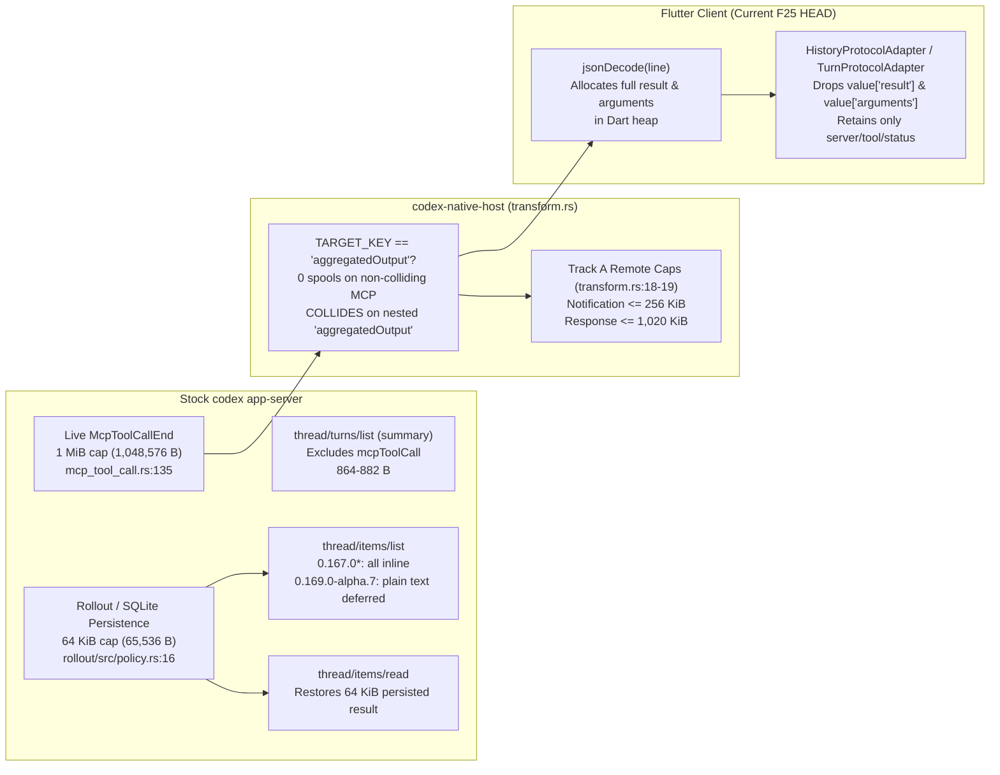

# Bounded Saved MCP Results and Eligible Plain-Text Readback: Stock `app-server`, `codex-native-host`, and Official Desktop Evidence

Date: 2026-11-10
Status: Complete (`LOCAL_SCHEMA` + `PUBLIC_SOURCE` + `STATIC_BUNDLE` + `DISPOSABLE_LIVE_PROBE`)
Scope: F26B independent schema, upstream Rust source, static bundle, and disposable headless live-probe comparison across installed stock `0.167.0-alpha.3.2`, official public stable `0.167.0`, Desktop-train public alpha `0.167.0-alpha.4.1`, higher public alpha `0.169.0-alpha.7`, public `openai/codex` (`caae161dd0c82f2e04e57e6f9d738fafbce503ba`, including [`e7f32cf48`](https://github.com/openai/codex/commit/e7f32cf48) and [`d2b4d6321`](https://github.com/openai/codex/commit/d2b4d6321)), and Official Codex Desktop (`26.1103.60933`, build `25894`).

---

## 1. Executive Summary

All live measurements in this document were collected from headless JSON-RPC probes using isolated disposable `/tmp` profiles, a disposable Python stdio MCP fixture (`fixture_mcp/fixture_tool`), and a loopback `/v1/responses` SSE server on `127.0.0.1` without launching the interactive packaged GUI or touching user credentials.

1. **Five Wire Surfaces, Non-Colliding MCP Pass-Through, and the `codex-native-host` `"aggregatedOutput"` Key-Collision Defect**:
   - In `native_host/src/transform.rs:12-20, 273`, `codex-native-host` matches `TARGET_KEY = b"aggregatedOutput"`. Across our 16 measured `mcpToolCall` cases (none of which contained an `"aggregatedOutput"` key inside `structuredContent` or `arguments`), `codex-native-host` wrote `0` completed spool files (`has_spool = false` across all 16 cases and all 4 binaries, including a `1.5 MiB` tool output), and every `mcpToolCall` JSONL frame crossed `codex app-server -> codex-native-host -> stdout` inline.
   - However, because `Transformer` sets `self.pending_target_depth = (key == TARGET_KEY).then_some(self.depth)` (`native_host/src/transform.rs:273`) at **any** JSON object nesting depth without checking item type or path — behavior explicitly asserted by the existing Rust unit test `handles_multiple_messages_nested_keys_and_non_string_values` (`native_host/src/transform.rs:638-656`) — `codex-native-host` does **not** leave all MCP payloads untouched: any nested `"aggregatedOutput": "<string>"` property inside `mcpServer/tool/call` responses, `mcpToolCall.result.structuredContent`, or `mcpToolCall.arguments` is replaced in-flight with `null` and a sibling `"_codexNativeOutput": {...}` descriptor is injected into that object.
   - **Independent Direct-Call Reproduction (`0.167.0-alpha.3.2` & `0.169.0-alpha.7`)**: Calling `mcpServer/tool/call` against a disposable MCP fixture returning `structuredContent.nested.aggregatedOutput = "<string>"` over direct `ProcessTransport -> stock app-server` preserved the string (`preserved = true, injected = false`), whereas the identical call through `ProcessTransport -> bundled codex-native-host -> stock app-server` mutated the nested property to `null` and injected `_codexNativeOutput` (`preserved = false, injected = true`) on both installed `0.167.0-alpha.3.2` and public alpha `0.169.0-alpha.7`. Fixing this depth-unscoped `"aggregatedOutput"` key collision in `native_host/src/transform.rs` is an independent **`READY`** correctness item and a prerequisite before claiming structured MCP fidelity.
   - On the Flutter side, `HistoryProtocolAdapter._parseItem` (`lib/src/protocol/history_protocol.dart:199-267`, `'mcpToolCall'` branch at `258-267`) and `TurnProtocolAdapter._parseItem` / `_activitySummary` (`lib/src/protocol/turn_protocol.dart:470-542, 559-567`) currently discard `value['result']` and `value['arguments']` after `jsonDecode` has already allocated the full JSON map in Dart heap memory.

2. **Two Distinct Stock Truncation Caps (`1 MiB` Live vs `64 KiB` Persisted), Core vs v2 API Envelope, & Untruncated Arguments**:
   - **Live `item/completed` notifications** (`codex-rs/core/src/mcp_tool_call.rs:135, 771, 1114-1128` -> `codex-rs/app-server/src/bespoke_event_handling.rs:1145-1161`) truncate `CallToolResult` at `MCP_TOOL_CALL_EVENT_RESULT_MAX_BYTES = DEFAULT_OUTPUT_BYTES_CAP = 1,048,576` bytes (**1 MiB**), **not** `64 KiB`.
   - **Persisted rollout/SQLite history** (`codex-rs/rollout/src/policy.rs:16, 269-283`, introduced in [`e7f32cf48`](https://github.com/openai/codex/commit/e7f32cf48)) truncates `EventMsg::McpToolCallEnd` and `TurnItem::McpToolCall` at `PERSISTED_MCP_RESULT_MAX_BYTES = 65,536` bytes (**64 KiB**) before writing the rollout entry (yielding a compact re-serialized `v2::McpToolCallResult` size of `result_json_bytes = 65,572` bytes per §4.1 for any capped item). Both warm `thread/items/list` (immediately after `turn/completed`) and cold `thread/items/list` / `thread/items/read` (after `thread/resume`) read from this `64 KiB`-capped rollout store.
   - **Core `CallToolResult` vs `app-server` `v2::McpToolCallResult` Envelope**: Internally and in rollout persistence, `codex-rs` stores `rmcp::model::CallToolResult { content, structured_content, is_error, _meta }`. When projecting to the `app-server` v2 protocol (`v2::McpToolCallResult`), the wire object exposes `{ content, structuredContent, _meta }` without an `isError` property; instead, `is_error == Some(true)` is projected onto outer `McpToolCall.status = "failed"` (as seen in `tool_is_error`). However, when `truncate_mcp_tool_result` falls back to whole-struct JSON serialization (`serde_json::to_string(&result)`), it serializes the internal `CallToolResult`, which is why `"isError":false` appears at the tail of truncated JSON-envelope text strings.
   - **`McpToolCall.arguments` is never truncated or deferred** by stock `codex-rs` on live notifications, persisted rollouts, `thread/items/list`, or `thread/items/read` (verified with `large_args_echo`, where `args_bytes = 20,518` bytes remained inline even when `outputDeferred: true` cleared `result.content` on `0.169.0-alpha.7`).
   - **`thread/turns/list` (`itemsView: "summary"`) never carries `mcpToolCall` items**: `TurnItemsView::project_items` (`codex-rs/app-server-protocol/src/protocol/turn_items_view.rs:34-61`) and `StoredTurnItemsView::Summary` (`codex-rs/thread-store/src/local/thread_history/segment_paging.rs:212-233`) retain only `[first_user_message, final_agent_message]` (`864–882` raw JSONL bytes total for our 16-tool turn).

3. **Version Split (`0.167.0*` Schema Absence + JSON-Envelope Truncation vs `0.169.0-alpha.7` Plain-Text Truncation + Selective Deferral)**:
   - On **installed `0.167.0-alpha.3.2`**, **public stable `0.167.0`**, and **Desktop-train `0.167.0-alpha.4.1`**:
     - Generated JSON schemas (`generate-json-schema [--experimental]`) **omit** `ThreadItemsListParams.deferOutput` and `ThreadItemEntry.outputDeferred` completely. At runtime, serde deserialization of `ThreadItemsListParams` ignores unknown fields, so passing `deferOutput` is **ignored unknown input (not schema support)** and returns full inline outputs (`cold_cmd_defer_bytes == cold_both_defer_bytes == 462,930–462,937` raw bytes; `0/16` items deferred).
     - Whenever `serde_json::to_string(&result)` exceeds the cap (`1 MiB` live or `64 KiB` persisted), `truncate_mcp_tool_result` serializes the entire internal `CallToolResult` JSON object (`{"content":[...],"isError":false}`) and wraps that mid-string-truncated JSON string inside a single `content[0] = {"type": "text", "text": "{\"content\":[{\"type\":\"text\",\"text\":\"...…N chars truncated…...\"}"}` block with `structuredContent: null`.
   - On **higher public alpha `0.169.0-alpha.7`** (tag `rust-v0.169.0-alpha.7` `25da1b0cb5e876882f8b1fafe186cdfcf3c712cc`, containing [`d2b4d6321`](https://github.com/openai/codex/commit/d2b4d6321)):
     - Experimental schema exposes `deferOutput: { commandExecution?: boolean, mcpToolCall?: boolean }` (gated on `initialize.capabilities.experimentalApi == true`).
     - In `codex-rs/app-server/src/request_processors/thread_processor.rs` (`defer_item_output` & `is_deferrable_mcp_result`) and `codex-rs/protocol/src/mcp.rs` (`plain_output_text`), `thread/items/list` with `deferOutput.mcpToolCall = true` replaces `result.content` with `[]` (`57` compact JSON bytes) and sets `outputDeferred: true` **only** for completed, non-error MCP calls (`server != "codex_app"`) without MCP app UI/resource metadata, without `structuredContent` or `_meta`, whose blocks all pass `plain_output_text(block)` (`6/16` cases in our matrix, reducing the `thread/items/list` JSONL response from `462,949` bytes to `266,377` bytes).
     - All **non-eligible** MCP results (`json_text_short`, `json_text_80k`, `structured_short`, `structured_80k`, `image_40k`, `image_80k`, `resource_embedded`, `annotated_text`, `tool_is_error`, `protocol_error`) remain **inline** (`outputDeferred: false`, `266,377` raw response bytes across our turn) and continue to use whole-struct JSON-envelope wrapping when truncated past `64 KiB`.
     - **Cross-version rollout caveat**: An `> 64 KiB` plain-text MCP result recorded on `0.167.0*` is persisted in the rollout file with `content[0].text` starting with `"{\"content\":..."` (`'{'`). Even if later read by `0.169.0-alpha.7`, `plain_output_text` rejects it because it starts with `'{'`, so it is **never deferred** on `0.169.0-alpha.7`.

---

## 2. Binary & Bundle Provenance

All 4 stock `codex` binaries were executed in isolated headless `/tmp` directories through `build/linux/x64/debug/bundle/codex-native-host`:
- For `0.167.0-alpha.3.2`, the probe executed `/opt/codex-desktop/resources/codex` (which is the `codex` binary on `PATH` in this workstation environment; `/usr/bin/codex` does not exist).
- For `0.167.0`, `0.167.0-alpha.4.1`, and `0.169.0-alpha.7`, the probe invoked `npx --yes @openai/codex@<version>` (which resolves the npm `@openai/codex-linux-x64` platform binary for each version). The table below records both the installed/extracted release binaries from `docs/reverse/PROVIDER_ACCOUNT_DIAGNOSTICS_EVIDENCE.md` and the npm platform tarballs used by `npx`.

| Artifact | Path / Acquisition | Reported Version / Build | Provenance / Tag Mapping | SHA-256 |
| :--- | :--- | :--- | :--- | :--- |
| **Installed Desktop Stock Binary** | `/opt/codex-desktop/resources/codex` | `codex-cli 0.167.0-alpha.3.2` | Packaged inside installed `codex-desktop 2026.11.08.211600-1` (resolved via `PATH`) | `c8242fc9e1bac7c6d661a228cecfaf50e6db74da219e4a9ca8912827e11607f0` |
| **Official Public Stable Binary** | `/tmp/native-f24-public-stock.kHdq5U/codex` (and `npx @openai/codex@0.167.0`) | `codex-cli 0.167.0` | Public tag `rust-v0.167.0` (`086ccc833bc9cf01024ad2dd6af7dbd421b6bf9a`) | `cdcb45aaa01d0f14e298985e09465aebccd47f64ecd298aea44814af7b62bbda` (release binary) |
| **Desktop-Train Public Alpha Binary** | `/tmp/native-f25-desktop-train.8q6EXA/codex` (and `npx @openai/codex@0.167.0-alpha.4.1`) | `codex-cli 0.167.0-alpha.4.1` | Public tag `rust-v0.167.0-alpha.4.1` (`d2c035639366e0bf2c316aa2065c24aabc12bcdc`) | `c3dea068c8794f1764051c1fd182ff0524352bbddf2f2638e72386b9b74368` (release binary) |
| **Higher Public Alpha Binary** | `/tmp/native-f24-public-alpha.xQsk4m/codex` (and `npx @openai/codex@0.169.0-alpha.7`) | `codex-cli 0.169.0-alpha.7` | Public tag `rust-v0.169.0-alpha.7` (`25da1b0cb5e876882f8b1fafe186cdfcf3c712cc`) | `b20e3a2f9a25ae9e4b29bfe68ef337757d818f85087ac701d745833894f04c7d` (release binary) |
| **Measured Official Desktop Bundle** | `/opt/codex-desktop/resources/app.asar` | `26.1103.60933` (build `25894`) | Installed Electron bundle shipping `0.167.0-alpha.3.2` (`webview/assets/async/182735.5b42af8792.js`, `941014.a3d6341f0c.js`, `835890.1bed1e2ec8.js`) | `121edc7be15b6870fbef8b10ec637be9baef4a629471d80e1192385cf40a4b14` |
| **Bundled Native Host** | `build/linux/x64/debug/bundle/codex-native-host` | Built from shared `F25` base `4c9ea61` | Local debug bundle Host executable | `990c9e3af7d1a13e46cc5b2bb2233c9eac1330e2d697263ffdfffc67567ff474` |
| **Upstream Public Source** | `https://github.com/openai/codex.git` | `caae161dd0c82f2e04e57e6f9d738fafbce503ba` | Key commits: [`e7f32cf48`](https://github.com/openai/codex/commit/e7f32cf48) (`#59601`), [`d2b4d6321`](https://github.com/openai/codex/commit/d2b4d6321) (`#60390`) | — |

---

## 3. Wire-to-Heap Pipeline & Host Spooling Boundary



### 3.1 `codex-native-host` Behavior on Non-Colliding MCP Payloads vs Nested `"aggregatedOutput"` Keys

In `native_host/src/transform.rs:12-20, 273`:

- `TARGET_KEY` is `b"aggregatedOutput"` (intended for `commandExecution.aggregatedOutput`).
- For MCP tool calls whose `result` (`{ content, structuredContent, _meta }`) and `arguments` objects do not contain a string property named `"aggregatedOutput"`, `codex-native-host` writes zero completed spool files (`spool_file_count = 2` directory entries in `--cache-dir` corresponding only to internal spool housekeeping, and `has_spool = false` across all 16 probe cases and all 4 binaries).
- **Depth-Unscoped `"aggregatedOutput"` Key Collision (`native_host/src/transform.rs:273, 638-656`)**: Because `self.pending_target_depth = (key == TARGET_KEY).then_some(self.depth)` triggers on `b"aggregatedOutput"` at **any** JSON object depth (covered by unit test `handles_multiple_messages_nested_keys_and_non_string_values`), any MCP `structuredContent` or `arguments` object (in `mcpServer/tool/call`, `item/started`, `item/completed`, `thread/items/list`, or `thread/items/read`) that contains `"aggregatedOutput": "<string>"` has its string value replaced with `null` and `"_codexNativeOutput": {"ref": ..., "bytes": ...}` injected into that nested object.

### 3.2 Dual Truncation Caps in Upstream `codex-rs`

Upstream `openai/codex` (`caae161dd0c82f2e04e57e6f9d738fafbce503ba`) applies two separate truncation caps:

1. **Stage 1 — Live Event Emission (`1 MiB` = `1,048,576` bytes)**:
   - In `codex-rs/core/src/mcp_tool_call.rs:135`, `MCP_TOOL_CALL_EVENT_RESULT_MAX_BYTES` is set to `DEFAULT_OUTPUT_BYTES_CAP` (`1,048,576` bytes from `codex-rs/utils/output-truncation/src/lib.rs:21`).
   - `sanitize_mcp_tool_result_for_event` (`codex-rs/core/src/mcp_tool_call.rs:1114-1128`) calls `truncate_mcp_tool_result(result, 1_048_576)` before emitting `EventMsg::McpToolCallEnd`, which `codex-rs/app-server/src/bespoke_event_handling.rs:1145-1161` forwards as `item/completed`.
   - Any MCP tool result up to **1 MiB** (`plain_80k`, `plain_300k`, `json_text_80k`, `structured_80k`, `image_80k`) therefore arrives **untruncated** on live `item/completed` (`82,511–307,840` raw JSONL frame bytes), and a `1.5 MiB` result (`plain_1500k`) arrives as a **`1,049,115–1,049,140`-byte** JSONL frame.

2. **Stage 2 — Rollout Persistence (`64 KiB` = `65,536` bytes)**:
   - Introduced in upstream commit [`e7f32cf48`](https://github.com/openai/codex/commit/e7f32cf48) (`codex-rs/rollout/src/policy.rs:16, 269-283`, `PERSISTED_MCP_RESULT_MAX_BYTES = 65_536`).
   - When persisting `EventMsg::McpToolCallEnd` or `EventMsg::ItemCompleted(TurnItem::McpToolCall)` to the rollout file, `persisted_mcp_tool_call_end_event` calls `truncate_mcp_tool_result(result, 65_536)`.
   - Both warm `thread/items/list` and cold `thread/items/list` / `thread/items/read` read from `LocalThreadStore` and return this `64 KiB`-capped `v2::McpToolCallResult` (`result_json_bytes = 65,572` compact bytes).

---

## 4. Four-Binary, 16-Case Disposable Live-Probe Matrix

### 4.1 Measurement Methodology

- **Raw Frame Bytes (`*_line_bytes`, `turns_summary_bytes`, `warm_*_defer_bytes`, `cold_*_defer_bytes`, `cold_read_all_bytes`)**: Exact UTF-8 byte length of the raw JSONL line emitted on `codex-native-host` stdout (including the trailing `\n`).
- **Compact Sub-Object Bytes (`result_json_bytes`, `args_bytes`)**: Compact UTF-8 JSON byte length (`len(json.dumps(obj, separators=(",", ":")).encode("utf-8"))`) of the parsed `item["result"]` (`v2::McpToolCallResult`) and `item["arguments"]` fields.

### 4.2 Whole-Turn Raw JSONL Frame Totals Across the 4 Binaries

| Metric | `0.167.0-alpha.3.2` (Installed) | `0.167.0` (Public Stable) | `0.167.0-alpha.4.1` (Desktop Alpha) | `0.169.0-alpha.7` (Higher Alpha) |
| :--- | ---: | ---: | ---: | ---: |
| `thread/turns/list` (`itemsView: "summary"`) raw frame bytes | `864 B` | `864 B` | `864 B` | `882 B` |
| `thread/turns/list` summary item types | `["userMessage", "agentMessage"]` | `["userMessage", "agentMessage"]` | `["userMessage", "agentMessage"]` | `["userMessage", "agentMessage"]` |
| Warm `thread/items/list` (`deferOutput: {commandExecution: true}`) | `462,934 B` | `462,929 B` | `462,936 B` | `462,948 B` |
| Warm `thread/items/list` (`deferOutput: {commandExecution: true, mcpToolCall: true}`) | `462,934 B` | `462,929 B` | `462,936 B` | **`266,376 B`** |
| Cold `thread/items/list` (`deferOutput: {commandExecution: true}`) | `462,935 B` | `462,930 B` | `462,937 B` | `462,949 B` |
| Cold `thread/items/list` (`deferOutput: {commandExecution: true, mcpToolCall: true}`) | `462,935 B` | `462,930 B` | `462,937 B` | **`266,377 B`** |
| Cold `thread/items/read` (`itemIds`: all 16 MCP items) | `462,081 B` | `462,076 B` | `462,083 B` | `462,077 B` |
| Deferred MCP items (`outputDeferred == true`) | `0 / 16` | `0 / 16` | `0 / 16` | **`6 / 16`** |
| Completed Host spool files (`has_spool == true` across the 16 non-colliding cases) | `0 / 16` | `0 / 16` | `0 / 16` | `0 / 16` |

### 4.3 Per-Case Raw Frame Totals vs Sub-Object Serialization (`Live`, `Listed`, `Deferred`, and `Read`)

*(Across all 16 cases, `0.167.0-alpha.3.2`, `0.167.0`, and `0.167.0-alpha.4.1` produced identical `result_json_bytes`, `block_types`, `first_text_bytes`, and `outputDeferred: false` values; raw JSONL frame bytes (`live_started_line_bytes` / `live_completed_line_bytes`) are listed separately from compact `item.result` sub-object bytes (`result_json_bytes`).)*

| Case ID | Input Payload Shape | Live `started` / `completed` Raw Frame Bytes (`0.167.0-a3.2` / `0.169.0-a7`) | Live `item/completed` `result_json_bytes` | Cold `thread/items/list` (`cmd` only) `result_json_bytes` | Cold `thread/items/list` (`cmd+mcp`) on `0.169.0-a7` (`outputDeferred` / `result_json_bytes`) | Cold `thread/items/read` (`0.167.0*` vs `0.169.0-a7` Persisted Shape) |
| :--- | :--- | ---: | ---: | ---: | :--- | :--- |
| `plain_short` | 1 unannotated `text` block (`35 B`) | `511 B` / `629 B` (`655 B` a7) | `121 B` | `121 B` | `true` / `57 B` (`content: []`) | `121 B` (`text`: `35 B`, exact match on both) |
| `plain_multiblock` | 2 unannotated `text` blocks (`12 B` + `12 B`) | `521 B` / `653 B` (`678 B` a7) | `139 B` | `139 B` | `true` / `57 B` (`content: []`) | `139 B` (`2` text blocks, exact match on both) |
| `plain_80k` | 1 unannotated `text` block (`81,920 B`) | `507 B` / `82,511 B` (`82,536 B` a7) | `82,007 B` | `65,572 B` | `true` / `57 B` (`content: []`) | **`0.167.0*`**: `text` (`65,467 B`) is serialized `CallToolResult` JSON `{"content":[{"type":"text","text":"HEADER_80K\np...`<br>**`0.169.0-a7`**: `text` (`65,478 B`) is plain text `"Truncated tool output:\nHEADER_80K\np..."` |
| `plain_300k` | 1 unannotated `text` block (`307,222 B`) | `509 B` / `307,815 B` (`307,840 B` a7) | `307,309 B` | `65,572 B` | `true` / `57 B` (`content: []`) | **`0.167.0*`**: `text` (`65,467 B`) serialized `CallToolResult` JSON<br>**`0.169.0-a7`**: `text` (`65,478 B`) `"Truncated tool output:\nHEADER_300K\nq..."` |
| `plain_1500k` | 1 unannotated `text` block (`~1.5 MiB`) | `511 B` / `1,049,115 B` (`1,049,140 B` a7) | `1,048,612 B` | `65,572 B` | `true` / `57 B` (`content: []`) | **`0.167.0*`**: double-wrapped JSON string (`"{\"content\":[{\"type\":\"text\",\"text\":\"{\\\"content\\\":"`, `65,441 B`)<br>**`0.169.0-a7`**: double-prefixed plain text (`"Truncated tool output:\nTruncated tool output:\nHE..."`, `65,477 B`) |
| `json_text_short` | 1 `text` block starting with `'{'` (`31 B`: `{"status":"ok","items":[1,2,3]}`) | `519 B` / `639 B` (`663 B` a7) | `122 B` | `122 B` | **`false`** / `122 B` (inline) | `122 B` (`text`: `31 B`; rejected by `plain_output_text` because it starts with `'{'`) |
| `json_text_80k` | 1 `text` block starting with `'{'` (`81,953 B`) | `515 B` / `82,559 B` (`82,584 B` a7) | `82,046 B` | `65,572 B` | **`false`** / `65,572 B` (inline) | `65,572 B` (`text`: `65,453 B` serialized `CallToolResult` JSON `"{\"content\":[{\"type\":\"text\",\"text\":\"{\\\"blob\\\":..."` on **all 4 binaries**) |
| `structured_short` | 1 `text` block (`23 B`) + `structuredContent: {"summary":"ok","count":2}` | `521 B` / `660 B` (`684 B` a7) | `145 B` | `145 B` | **`false`** / `145 B` (inline) | `145 B` (`has_structured: true`, `text`: `23 B` on all 4 binaries) |
| `structured_80k` | `content: []` + `80 KiB` `structuredContent` | `517 B` / `82,526 B` (`82,550 B` a7) | `82,011 B` | `65,572 B` | **`false`** / `65,572 B` (inline) | `65,572 B`: `structuredContent` becomes `null` and is replaced by `content[0].text` (`65,467 B`) containing mid-string-truncated JSON `"{\"content\":[],\"structuredContent\":{\"huge\":\"sssss..."` on **all 4 binaries** |
| `image_40k` | 1 `image` block (`40 KiB` base64 `image/png`) | `507 B` / `40,614 B` (`40,638 B` a7) | `40,111 B` | `40,111 B` | **`false`** / `40,111 B` (inline) | `40,111 B` (`block_types: ["image"]` preserved intact because `< 64 KiB`) |
| `image_80k` | 1 `image` block (`80 KiB` base64 `image/png`) | `507 B` / `82,534 B` (`82,558 B` a7) | `82,031 B` | `65,572 B` | **`false`** / `65,572 B` (inline) | `65,572 B`: `image` block is replaced on persistence by `block_types: ["text"]` (`65,465 B`) containing `"{\"content\":[{\"type\":\"image\",\"data\":\"BBBB..."` on **all 4 binaries** |
| `resource_embedded` | 1 `resource` block (`uri: "file:///workspace/note.txt"`, `text: "Embedded resource body"`) | `523 B` / `715 B` (`740 B` a7) | `200 B` | `200 B` | **`false`** / `200 B` (inline) | `200 B` (`block_types: ["resource"]` on all 4 binaries) |
| `annotated_text` | 1 `text` block (`20 B`) with `annotations: {"audience":["user"],"priority":0.8}` | `517 B` / `670 B` (`695 B` a7) | `161 B` | `161 B` | **`false`** / `161 B` (inline) | `161 B` (rejected by `plain_output_text` because the block has 3 fields instead of 2) |
| `tool_is_error` | 1 `text` block (`40 B`) with `isError: true` | `515 B` / `634 B` (`659 B` a7) | `125 B` | `125 B` | **`false`** / `125 B` (inline) | `125 B` (`status: "failed"`, excluded from deferral because `status != Completed`) |
| `protocol_error` | JSON-RPC `-32603` error from MCP server | `517 B` / `666 B` (`691 B` a7) | `null` | `null` | **`false`** / `null` | `status: "failed"`, `result: null`, `error.message: "tool call error: ..."` |
| `large_args_echo` | `20,518 B` `arguments` + `25 B` plain `text` result | `21,008 B` / `21,115 B` (`21,140 B` a7) | `110 B` | `110 B` | `true` / `57 B` (`args: 20,518 B` inline) | `args: 20,518 B`, `result: 110 B` (`arguments` is never deferred or truncated) |

---

## 5. Upstream Source Contract: Deferral Eligibility vs Truncation (`PUBLIC_SOURCE`)

Cross-referenced against pinned public `openai/codex` commit `caae161dd0c82f2e04e57e6f9d738fafbce503ba` and public tag `rust-v0.169.0-alpha.7` (`25da1b0cb5e876882f8b1fafe186cdfcf3c712cc`, containing [`e7f32cf48`](https://github.com/openai/codex/commit/e7f32cf48) and [`d2b4d6321`](https://github.com/openai/codex/commit/d2b4d6321)):

1. **Per-Block Plain-Text Predicate (`codex-rs/protocol/src/mcp.rs`, `plain_output_text`)**:
   - Inspects a **single** content block (`& serde_json::Value`).
   - Requires the block to be a JSON object with **exactly 2 fields** (`fields.len() == 2`) where `"type" == "text"` and `"text"` is a string. Any extra property on the block (such as `"annotations"` in `annotated_text`) fails the 2-field check.
   - Trims leading whitespace and UTF-8 BOM (`ch.is_whitespace() || ch == '\u{feff}'`) and rejects any text starting with `'{'`, `'['`, ```` ``` ````, or `'~~~'`.
2. **List-Time MCP Deferral Guards (`codex-rs/app-server/src/request_processors/thread_processor.rs`, `defer_item_output` & `is_deferrable_mcp_result`)**:
   - At the request/entry level, `defer_item_output` requires `params.turn_id.is_some()`, `entry.completed_at_ms.is_some()`, `options.mcp_tool_call == true`, `server != "codex_app"`, `status == McpToolCallStatus::Completed`, `result: Some(result)`, `error: None`, `app_context.as_ref().is_none_or(|ctx| ctx.resource_uri.is_none())`, `mcp_app_resource_uri: None`, and `mcp_app_ui: None`.
   - Inside `is_deferrable_mcp_result(result)`, stock checks `result.structured_content.is_none()`, `result.meta.is_none()`, that every block in `result.content` satisfies `codex_protocol::mcp::plain_output_text(block)`, and that at least one block has nonempty text.
   - When eligible, `defer_item_output` clears `result.content` (`[]`) and sets `entry.output_deferred = true`.
3. **Truncation Classification & Full Serialized-Result Cap Loop (`codex-rs/utils/output-truncation/src/lib.rs`, `truncate_mcp_tool_result`)**:
   - Related to, but distinct from, `is_deferrable_mcp_result`: when `serde_json::to_string(result)` exceeds `max_bytes` (`1,048,576` B live or `65,536` B persisted), `truncate_mcp_tool_result` checks whether `result.is_error != Some(true)`, `result.structured_content.is_none()`, `result.meta.is_none()`, and all blocks pass `codex_protocol::mcp::plain_output_text`.
   - **Plain-Text Assembly & Full Serialized-Result Cap Loop**: On `0.169.0-alpha.7` (with [`d2b4d6321`](https://github.com/openai/codex/commit/d2b4d6321)), when the plain-text check succeeds, `truncate_mcp_tool_result` starts with the `"Truncated tool output:"` header and appends one newline (`'\n'`) followed by each plain-text block (`"Truncated tool output:\n<block>"`), which remains eligible for `deferOutput.mcpToolCall`. Whether truncating plain text or truncating the serialized `CallToolResult` JSON string (`0.167.0*` for all results, and `0.169.0-alpha.7` for non-plain results), `truncate_mcp_tool_result` runs an iterative shrinking-budget loop checking `serde_json::to_string(&candidate)?.len() <= max_bytes` (reducing the text budget by the byte overshoot on each iteration) so that the **entire serialized `rmcp::model::CallToolResult` struct** fits within `max_bytes` (`<= 65,536` bytes on persistence, or `<= 1,048,576` bytes on live `McpToolCallEnd`). When the resulting `v2::McpToolCallResult` is compact-serialized per §4.1 (with explicit `"structuredContent":null` that `rmcp::model::CallToolResult` omits when `None` via `skip_serializing_if`), the capped `v2::McpToolCallResult` sub-object measures `65,572` compact bytes (`1,048,612` compact bytes at the `1 MiB` live cap).
   - Because `plain_1500k` exceeds both the `1 MiB` live cap and the `64 KiB` rollout cap, `truncate_mcp_tool_result` runs twice on `0.169.0-alpha.7` and prepends `"Truncated tool output:\n"` twice (`"Truncated tool output:\nTruncated tool output:\nHEADER_1500K..."`).
   - On `0.167.0-alpha.3.2`, `0.167.0`, and `0.167.0-alpha.4.1` (for **all** results), and on `0.169.0-alpha.7` (whenever the plain-text check fails, such as `json_text_80k`, `structured_80k`, or `image_80k`), `truncate_mcp_tool_result` serializes the internal `CallToolResult` struct (`{"content":[...],"isError":false}`) to JSON, middle-truncates that JSON string (`"…N chars truncated…"`), and places the broken JSON string into `content[0].text` with `structuredContent: null`.

---

## 6. Official Codex Desktop (`26.1103.60933`, `app.asar`) Static Audit (`STATIC_BUNDLE`)

We inspected `/opt/codex-desktop/resources/app.asar` (which ships with stock `0.167.0-alpha.3.2`) by mapping absolute archive offsets to the archived webview bundles:

1. **No Alpha Output Deferral in Measured Desktop `26.1103.60933`**:
   - Across the entire `/opt/codex-desktop/resources/app.asar` archive, string counts are `deferOutput = 0`, `outputDeferred = 0`, `thread/items/read = 0`, and `thread/items/list = 28`. Measured Desktop `26.1103.60933` hydrates `thread/items/list` inline against its bundled `0.167.0-alpha.3.2` runtime.
2. **`codex_app` Server Rewrite (`webview/assets/async/182735.5b42af8792.js`, absolute archive offsets `113,936,800..113,937,750`)**:
   - Anchored at `mcpToolCall` (absolute archive offset `113,937,563`), `codex_app` (`113,937,587`), and `dynamicToolCall` (`113,937,688`): when projecting thread items, if `item.type === "mcpToolCall"` and `item.server === "codex_app"`, Desktop rewrites the item in memory into `type: "dynamicToolCall"` (`tool`, `arguments`, `contentItems`, `success`).
3. **Conversation Projection vs Export Budget (`webview/assets/async/182735.5b42af8792.js` & `webview/assets/async/941014.a3d6341f0c.js`)**:
   - Anchored at `projectionBudget` in `webview/assets/async/182735.5b42af8792.js` (absolute archive offset `113,939,005`, within `113,932,600..113,939,200`) and in `webview/assets/async/941014.a3d6341f0c.js` (absolute archive offset `547,264,397`): in normal conversation timeline projection, `projectionBudget` is omitted, and a character budget is only supplied during Markdown conversation export at offset `547,264,397`.
4. **Single JSON-Text Auto-Promotion & Block Renderers (`webview/assets/async/835890.1bed1e2ec8.js`, absolute archive offsets `475,064,500..475,093,000`)**:
   - Anchored at `displayStructuredContentJson` (absolute archive offset `475,082,308`) and `JSON.parse` (`475,082,892`): when rendering an `mcp-tool-call` card, if `result.structuredContent == null` and `result.content` has length `1` with an unannotated `text` block whose trimmed string starts with `'{'` or `'['`, Desktop attempts `JSON.parse(block.text)` and promotes a valid parsed object/array into `displayStructuredContentJson`.
   - If `JSON.parse` throws (including when `truncate_mcp_tool_result` mid-string-truncated a `> 64 KiB` payload), Desktop falls back to rendering the raw string inside a scrollable `<pre>` text block (`max-h-60 overflow-y-auto`).
   - Content block rendering: `text` renders in `<pre>` with a `Raw` modal button; `image` renders only when `mimeType` starts with `image/` and `data` is non-empty; `audio` renders as an `[audio (${mimeType})]` pill; `resource` and `resource_link` render URI/title metadata pills.

---

## 7. Research Notes & Boundary Implications for Future Native Slices (`RESEARCH_MORE`)

1. **Fix `codex-native-host` `"aggregatedOutput"` Key Collision First (`READY` Prerequisite)**:
   - Before any future Native slice claims structured MCP result or `mcpServer/tool/call` fidelity, `native_host/src/transform.rs` must be updated so `"aggregatedOutput"` spooling is scoped to `commandExecution` items rather than mutating arbitrary nested `"aggregatedOutput": "<string>"` fields inside MCP `structuredContent` or `arguments`.
2. **Local-Only Bounded MCP Result Projection vs Direct Host Remote Allowlist**:
   - A future local-only bounded MCP result viewer (`RESEARCH_MORE`) does **not** require expanding the Direct Host Remote allowlist (`native_host/src/remote_bridge.rs:273-288`), because local `ProcessTransport` can either keep `deferOutput: {'commandExecution': true}` (and bound inline `result` / `arguments` at parser ingress) or pass local-only deferral parameters without changing Remote's `validate_thread_items_list` contract (`defer_obj.len() == 1 && defer_obj.get("commandExecution") == Some(true)`).
   - Shared `HistoryProtocolAdapter.listItems` (`lib/src/protocol/history_protocol.dart:128-145`) must **not** unconditionally add `'mcpToolCall': true` while `RemoteTransport.listHistoryItems` delegates to it unless `remote_bridge.rs` and runtime capability fallbacks are intentionally updated in the same slice.
3. **Bounded Parser Ingress Without Guessing Provenance (`RESEARCH_MORE`)**:
   - Because `0.167.0*` never defers MCP results, `0.169.0-alpha.7` leaves `10/16` payload shapes inline (`266,377` B in our 16-item turn), `arguments` (`20,518` B in `large_args_echo`) is never truncated, and live `item/completed` carries up to `1 MiB` inline, any future Native MCP result projection must enforce strict char/byte caps at parser ingress (`lib/src/protocol/history_protocol.dart:258-267`, `lib/src/protocol/turn_protocol.dart:470-542`) rather than retaining raw `result` or `arguments` maps in timeline state.
   - Do **not** label arbitrary malformed JSON starting with `'{"content":'` with a definitive `"Truncated by Codex runtime at 64 KiB"` badge or strip repeated `"Truncated tool output:\n"` prefixes without typed protocol provenance, because a tool or user fixture can emit malformed JSON or literal prefix text on its own. If `JSON.parse` / `jsonDecode` fails on a text block starting with `'{'` or `'['`, simply fall back to a bounded plain-text preview.
   - For items where `outputDeferred == true` on `0.169.0-alpha.7+`, on-demand `thread/items/read` (`lib/src/protocol/history_protocol.dart:147-165`) can restore the saved `<= 64 KiB` plain-text result when requested by the user.
4. **Track A Remote Size Extrapolation (Source + Measured Frame Sizes)**:
   - By source inspection of `native_host/src/transform.rs:18-19` (`MAX_REMOTE_RESPONSE_BYTES = 1,044,480` B; `MAX_REMOTE_NOTIFICATION_BYTES = 262,144` B) combined with our local loopback frame measurements (without running a live Remote WebSocket session in this probe):
     - A live `item/completed` notification for an MCP result between `~256 KiB` and `1 MiB` (such as `plain_300k` at `307,840` frame bytes or `plain_1500k` at `1,049,140` frame bytes) exceeds `MAX_REMOTE_NOTIFICATION_BYTES` (`262,144` B), which in `transform.rs:339-350` sets `captured.payload = None` and triggers a Remote resync.
     - A `thread/items/list` response containing `>= 17` non-deferred `64 KiB`-capped MCP items (`17 x 65,572 B > 1,044,480 B`) would exceed `MAX_REMOTE_RESPONSE_BYTES` and return `-32002` on Remote.
