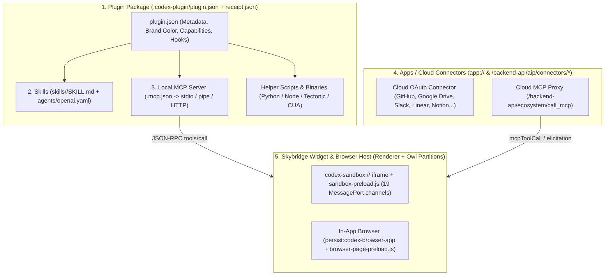

# ChatGPT Desktop (`26.1103.32239`) — Plugins, Apps, Skills, MCP, and Capability Host Map

> **Scope**: Disentangles the five overlapping capability abstractions in ChatGPT Desktop (`Plugins`, `Skills`, `MCP Servers`, `Apps/Connectors`, and `Skybridge Widget Sandboxes`), documents all bundled plugins in `26.1103.32239`, and defines the **Shared Capability Host** architecture for `Codex-Native-Unoffical`.

---

## 1. Taxonomy: Plugins vs Skills vs MCP vs Apps vs Skybridge Widgets

In ChatGPT Desktop `26.1103.32239`, these five terms refer to distinct layers of a single capability stack:

| Concept | Definition in `26.1103.32239` | Where It Lives | How the Agent Invokes It | Classification |
| :--- | :--- | :--- | :--- | :--- |
| **1. Plugin** | A signed distributable bundle (`.codex-plugin/plugin.json` + Ed25519 `receipt.json`) that packages **Skills**, **MCP servers**, **lifecycle hooks** (`Stop`, `Interrupt`, `SubagentStop`), and **helper scripts/assets** as a single installable unit. | `/opt/codex-desktop/resources/plugins/openai-bundled/plugins/*` & `~/.codex/plugins/` | Managed via `codex app-server` RPCs: `plugin/list`, `plugin/read`, `plugin/install`, `plugin/uninstall`. | `PUBLIC_SUPPORTED` (via `app-server`) |
| **2. Skill** | A prompt-and-script workflow module defined by `SKILL.md` (YAML frontmatter `name`, `description` + Markdown instructions) and optional `agents/openai.yaml` (`display_name`, `default_prompt`, `allow_implicit_invocation`). | Inside a plugin (`plugins/<id>/skills/<skill>/SKILL.md`), workspace (`.agents/skills/`), or `~/.codex/skills/`. | Explicit `$skill-name` mention in composer (`type: "skill"` user input) or implicit model selection via `skills/list`. | `PUBLIC_SUPPORTED` |
| **3. MCP Server** | A Model Context Protocol server speaking JSON-RPC (`tools/list`, `tools/call`, `resources/read`, elicitation). Can be standalone (`config.toml` `mcp_servers.*`) or bundled inside a plugin (`.mcp.json`). | Local `stdio` process, local named pipe (`CODEX_APP_TOOLS_PIPE_PATH`), or `streamable_http`. | Directly exposed as `mcp__<server>__<tool>` or `namespace` tools inside `codex app-server`. | `PUBLIC_SUPPORTED` |
| **4. App / Connector** | A cloud OAuth integration (`app://<connectorId>`, e.g., Google Drive, GitHub, Slack, Linear) managed on `chatgpt.com`. | `/backend-api/aip/connectors/*` and `/backend-api/ecosystem/call_mcp` (or `codex_apps` MCP server in `app-server`). | Referenced via `@App` (`app://`) in composer; tool calls require OAuth consent or `codex_mcp_elicitation` approval. | `PRIVATE_COMPATIBILITY` / `SERVER_ONLY` |
| **5. Skybridge Widget (`codex-sandbox://`)** | An isolated HTML/JS visual widget (charts, calendars, flamecharts, stacktraces, interactive MCP app views) rendered inline in a turn or in a side panel. | `codex-sandbox://` custom scheme iframe with `sandbox-preload.js`. | Emitted by `visualize` skill (`<viz-*>`, `mountChart`) or MCP app tool outputs; communicates via 19 `MessagePort` channels. | `LOCAL_IMPLEMENTATION_DETAIL` |

---

## 2. Complete Inventory of Bundled Plugins (`resources/plugins/openai-bundled/`)

Every bundled plugin in `/opt/codex-desktop/resources/plugins/openai-bundled/` is cryptographically signed in `receipt.json` (`signer_id: "codex-plugin-Signer-prod-1"`, Ed25519 signature over the canonical manifest of SHA-256 file hashes):

| Plugin Name | Version | Category | Bundled MCP Server(s) | Bundled Skills (`SKILL.md`) | Architectural Purpose & Key Mechanics |
| :--- | :--- | :--- | :--- | :--- | :--- |
| **`codex-app-tools`** | `26.1103.32239` | Developer Tools (Hidden auto-installed: `xGqk`) | `codex_app` (`./scripts/launch_codex_app_tools_mcp ./server.mjs`) | *(None — pure MCP server)* | Bridges the agent back to the desktop UI over `CODEX_APP_TOOLS_PIPE_PATH`. Exposes 7 prompt-gated tools: `automation_update`, `create_thread`, `delete_thread`, `send_message_to_thread`, `fork_thread`, `handoff_thread`, `move_thread_to_project`. Outputs `<codex_delegation>` XML blocks (`EMCu`). |
| **`browser`** | `26.1103.32239` | Engineering | Uses `node_repl` MCP server + `browser-service.mjs` (`1.6 MB`) + `browser-accessibility.wasm.br` (`4.08 MB`) | `control-in-app-browser` | Controls the in-app Chromium browser (`persist:codex-browser-app`, codenamed `iab` / `Dot`). Supports AX-tree diffing (`tab.ax.write()`), Playwright locators, CDP (`tab.capabilities.get("cdp")`), Sign in with ChatGPT (`siwc`), secure credential fill (`browserAuth`), WebMCP (`webmcp`), and `plugin://browser@openai-bundled?mention=tab-v1...` tab mentions. |
| **`chrome`** | `26.1103.32239` | Productivity | `browser-service.mjs` + Native Messaging Host | `control-chrome-browser` | Controls the user's external Chrome / Edge / Brave / Opera / Vivaldi browser via WebExtensions (`hehggadaopoacecdllhhajmbjkdcmajg`, `odlomjlbamekndcpllcnffbgeohgkmjh`), with explicit tab claiming (`mentionedBrowser.user.claimTab(tab)`) and turn-end tab cleanup (`markDeliverable`, `markHandoff`). |
| **`unified-computer-use`** | `26.1103.32239` | Engineering (Hidden auto-installed: `xGqk`) | `unified_computer_use` (spawns native sidecar `resources/cua_node`) | `computer-use` | Provides OS-level desktop screen capture, accessibility tree inspection, and mouse/keyboard automation via `cua_node`. |
| **`latex`** | `0.2.8` | Education & Research | *(None — Python scripts + shared `CODEX_TECTONIC_PATH`)* | `latex-compile`, `latex-doctor`, `texlive-runtime-installer` | Compiles `.tex` projects using the bundled `resources/tectonic` (`0.17.0`) binary first for simple documents, falling back to system TeX Live/MacTeX or an opt-in user-scoped `~/.cache/codex-runtimes/codex-texlive/full` install. |
| **`deep-research`** | `0.1.1` | Research | *(None — orchestrates subagent + `$documents`)* | `deep-research` | Configures `xhigh` reasoning effort, delegates multi-pass web/source discovery to a dedicated research subagent, writes a cited `report-source.md` ledger, and produces a visually verified `.docx` deliverable. |
| **`visualize`** | `1.0.84` | Productivity | *(None — `render.py` + `chart_check.mjs` + Skybridge runtime)* | `visualize` | Authors interactive charts (`area`, `bar`, `boxPlot`, `funnel`, `heatmap`, `histogram`, `line`, `pie`, `ranking`, `sankey`, `scatter`, `sparkline`, `waterfall`) and widgets (`<viz-calendar>`, `<viz-flame-chart>`, `<viz-stack-trace>`, `<viz-waterfall>`) loaded from `persistent.oaistatic.com/plugins/visualize/*`. |

### 2.1 Additional Built-In Plugin Identifiers Registered in `xGqk` (`972499.b9f8eb2bc4.js`)

Beyond the 7 directories in `openai-bundled`, module `xGqk` registers internal/curated plugin descriptors:
- `computer-use` (`installWhenMissingRequiresOptIn: true`)
- `messages`
- `record-and-replay`
- `computer-history`
- `notebook` (`installWhenMissing: true`)
- `plan` (`plan@openai-bundled`, `installWhenMissing: true`)

---

## 3. Skybridge Widget Sandbox (`codex-sandbox://`) & `MessagePort` Bridge

When an assistant turn or MCP app renders an interactive HTML widget (`visualize`, `mcpapps`, or artifact preview), ChatGPT Desktop does **not** inject raw HTML into the main React DOM. Instead:

1. **Custom Scheme Isolation (`codex-sandbox://`)**:
   - The widget loads inside a sandboxed `<iframe src="codex-sandbox://...">` with `sandbox-preload.js`.
   - CSP restricts network access to approved static CDNs (`persistent.oaistatic.com`) or declared MCP app origins.
2. **19 `MessagePort` Channels**:
   - Communication between the main renderer and the sandboxed iframe uses dedicated `MessagePort` channels for:
     - `widgetState` (`getWidgetState` / `setWidgetState(snapshot)` — persisted per message so interactive filter/control state survives thread reloads!).
     - Intrinsic height/resize reporting (auto-sizing the iframe in the conversation column without scrollbars).
     - Theme synchronization (injecting `--color-*`, `--chart-*`, and light/dark mode variables into the iframe).
     - Tool invocation / follow-up prompt dispatch (`sendFollowUpMessage`, `callMcpTool`).
     - File download & fullscreen/side-panel expansion requests.

---

## 4. Shared Capability Host Design for `Codex-Native-Unoffical`

### 4.1 What Stock `codex app-server` Already Gives Us for Free (`PUBLIC_SUPPORTED`)

Because our architecture preserves stock `codex app-server`, **we do not need to reimplement a custom skill parser, plugin manager, or MCP protocol client**:
- `skills/list`, `skills/config/write`, and `$skill` user input items are natively executed by `codex app-server`.
- `plugin/list`, `plugin/read`, `plugin/install`, and `plugin/uninstall` are natively managed by `codex app-server`.
- `config/mcpServer/reload`, `mcpServerStatus/list`, `mcpServer/oauth/login`, and `mcpServer/elicitation/request` are natively handled by `codex app-server`.

### 4.2 What the Native Client & `codex-native-host` Should Provide

We recommend a clean **3-Tier Shared Capability Host** shared across Chat, Work, and Codex:

| Tier | Responsibility | Native vs WebView Decision |
| :--- | :--- | :--- |
| **Tier 1: Native Capability & Elicitation Surface (Flutter)** | - Skills & Plugins Browser / Manager UI (`plugin/list`, `skills/list`) - Composer `$skill` & `@mention` autocomplete - MCP Server status badges, OAuth login launch (`mcpServer/oauth/login`), and inline MCP tool approval / elicitation cards (`mcpServer/elicitation/request`) - Native rendering of standard charts (`line`, `bar`, `pie`, `area`, `scatter`, `stacktrace`, `calendar`) and LaTeX (`flutter_math_fork` + optional local `tectonic` PDF preview) | **100% Native Flutter** (zero WebView overhead, instant mount, bounded memory). |
| **Tier 2: Host-Managed Local App Tools (`codex-native-host`)** | - Expose an optional local MCP server (`codex_app` compatible) over stdio/unix-socket from `codex-native-host` so the agent can request prompt-gated thread actions (`create_thread`, `fork_thread`, `handoff_thread`, `send_message_to_thread`) with native user confirmation cards. | **100% Native Rust (`codex-native-host`) + Flutter Approval Card**. |
| **Tier 3: On-Demand Sandboxed WebView (`Skybridge` / `MCP Apps` fallback)** | - Only when an MCP server or `visualize` output produces custom arbitrary HTML/JS/3D WebGL widgets that cannot be represented by native Flutter blocks, mount an **on-demand, disposable system WebView** (`webview_flutter` / `flutter_inappwebview`) with a strict CSP and `postMessage` bridge (`setWidgetState`, resize, theme tokens), and **dispose it immediately when scrolled far off-screen or when switching threads**. | **On-Demand Disposable WebView** (complies with Rule 5 in `AGENTS.md`: *"Optional plugin web UI may use a system/embedded WebView later, only when required"*). |
